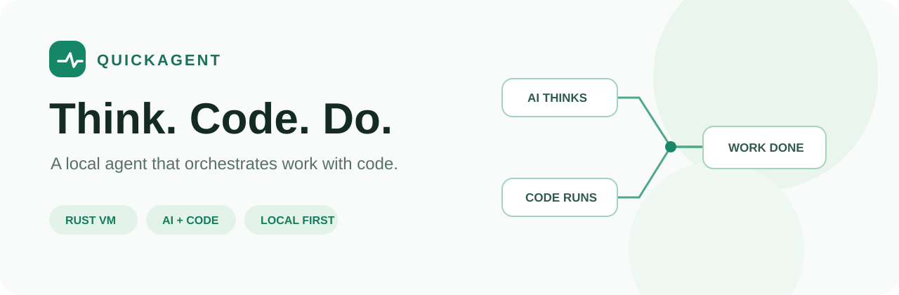
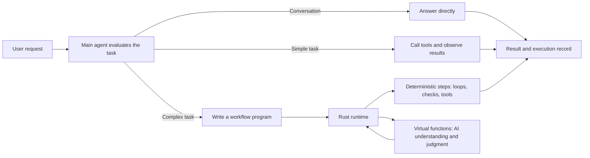

<p align="center">
  
</p>

<h1 align="center">QuickAgent</h1>

<p align="center"><a href="README.md">简体中文</a> | English</p>

<p align="center"><strong>Orchestrate work with code. Let AI focus on understanding, judgment, and creation.</strong></p>

<p align="center">Local agent · Rust runtime · JavaScript workflows · Virtual functions · Reuse on demand</p>

---

QuickAgent is a local agent for working on projects. It can answer questions directly, use tools for simple tasks, or write workflow programs for more complex work. Those programs organize loops, concurrency, file operations, and steps that need AI judgment.

The **Quick** in the name reflects the VM design's inspiration from QuickJS and the goal of keeping the agent responsive during longer tasks. The current executor uses SWC for parsing and a Rust-built virtual machine that implements a subset of JavaScript; it is neither a complete JavaScript runtime nor QuickJS itself.

> The project is under active development. Results and execution times vary with the model, tools, and task.

## How it works



**Handle simple requests directly.** Reading a file or answering a question does not require generating a program first.

**Use code to organize complex work.** The main agent can express deterministic steps in code and delegate judgment to virtual functions. Each virtual function has a responsibility, parameters, and its own working context. Workflows can also use `async` / `await` and `Promise` to coordinate asynchronous work.

**Refer to past workflows when useful.** The host saves main workflow source by project, making it discoverable across conversations. Execution records retain the source used for each run. Before adapting an older workflow, the agent still needs to check the current task and project.

### A simple workflow

```text
Read project material
    ↓
Virtual function: understand requirements and generate content
    ↓
Code: write files using a template
    ↓
Read the actual files → check results → report
```

Here AI handles understanding and generation, while code specifies file operations and step order. A virtual function can also use tools directly within its assigned responsibility; files are shared state visible to each step.

## Key capabilities

| Capability | Description |
| --- | --- |
| **Conversation and tool loop** | Read, search, edit files, and run commands as needed, without forcing every task into a workflow program. |
| **Code orchestration** | Express sequencing, branches, loops, functions, error handling, and asynchronous coordination using a JavaScript subset. |
| **Virtual functions and modules** | `@virtual` handles a responsibility requiring AI judgment; `@module` produces reusable workflow code from a contract. |
| **Function scopes** | Virtual functions use separate working contexts and receive relevant material through parameters and declared scope. |
| **Project tools** | File access, search, commands, code indexes, browser operations, and visual analysis, subject to permissions and configuration. |
| **Records and recovery** | Save conversations, tool calls, workflow source, and execution events; inspect history, file diffs, and related context on demand. |
| **Web and desktop** | A web interface and a desktop shell built with Tauri. |

See the [workflow language guide](docs/agent-program.md) for supported syntax and limitations (currently in Chinese).

## Experiments

These are observations from specific models and tasks, not guarantees for all workloads or controlled comparisons with other agents.

| Experiment | Observations |
| --- | --- |
| **Multi-turn MiniWebpack development** | Using `gpt-6-luna` high, development continued through turn 27, covering configuration files, multiple entries, and watch mode. The experiment reported peak context usage of about 22% and found no meaningless repeated steps. In turn 24, the model said it would fix a test without executing the fix; it completed the fix after a follow-up in turn 25. The same conversation was used throughout, but the service was restarted during the experiment. |
| **50 HTML presentation pages** | One `gpt-6.1-terra` low run took about 84 seconds and made 15 model calls. The workflow generated content in concurrent batches and used code to apply a common template and navigation. Page checks still found some viewport-height and title-format issues. |
| **Simple task** | In one `gpt-6-luna` high run, creating a file and reading it back took about 11.55 seconds and four model requests, without generating a workflow program. |

**A completed run is not the same as acceptance.** Experiments have included failing tests, follow-up fixes, and output details requiring attention. The goal is to make problems observable and work resumable, not to assume every run is correct.

## Getting started

### Web app

Install Rust, Cargo, Node.js, and npm. From the repository root:

```sh
npm --prefix frontend ci
npm --prefix frontend run build
cargo run
```

Open **http://127.0.0.1:3001/agent** and configure a model provider, credentials, and the main agent model in Settings. For frontend development, use `npm --prefix frontend run dev`; the development server proxies to the local agent service by default.

### Desktop app

The desktop app reuses the web interface and Rust agent through Tauri. Windows requires MSVC build tools and WebView2; Ubuntu requires WebKitGTK and other system dependencies. Install the [Tauri 2 prerequisites](https://v2.tauri.app/start/prerequisites/), then run from the repository root:

```sh
npm --prefix frontend ci
node desktop/prepare.mjs
cargo run --manifest-path desktop/Cargo.toml
```

See the [desktop guide](desktop/README.md) for development, packaging, and platform notes. Windows and Ubuntu must be built and validated separately.

### Common configuration

| Environment variable | Purpose |
| --- | --- |
| `WORKSPACE_ROOT` | Default task workspace; the startup directory by default. |
| `AGENT_BIND` | Agent service address; defaults to `127.0.0.1:3001`. |
| `MCP_BIND` | MCP service address; defaults to `127.0.0.1:3000`, with `/mcp` as its endpoint. |
| `GROW_CONFIG_DIR` | Configuration directory; defaults to `~/.config/grow` (honours `XDG_CONFIG_HOME`; `%APPDATA%\grow` on Windows). On first start without a configuration, the old one is copied once from `~/.dsh`. |
| `AGENT_WEB_DIR` | Frontend build output directory; defaults to `frontend/dist`. |

Configuration and conversations are stored locally. The desktop app uses the system application data directory by default; projects can be selected in the interface.

## Permissions and execution boundaries

QuickAgent can read and modify project files and, depending on permissions, run commands. Choose permissions appropriate to the task.

On Linux, workspace execution uses **bubblewrap** to restrict command writes outside the workspace. It requires `bwrap` and the necessary namespace support; it does not restrict network access or file reads. Full-access mode does not use this isolation. Windows does not currently provide an equivalent command-process sandbox, and the desktop shell does not provide one by itself.

## Documentation and development

The following technical documents are currently in Chinese:

- [Agent design](docs/agent-design-guide.md): core architecture and design principles. Some documentation may lag behind the implementation; consult the current code for actual behavior.
- [Workflow language guide](docs/agent-program.md): virtual functions, modules, concurrency, tools, and supported syntax.
- [Desktop app](desktop/README.md): Tauri development and packaging.
- [Skill package interface](docs/skill_packages.md): extending skills and tools.
- [Model request diagnostics](docs/model_request_diagnostics.md): troubleshooting connections and request stages.
- [Previous technical README](README-technical.md): a snapshot of the earlier detailed documentation; some content may be outdated.

Run project tests:

```sh
cargo test
npm --prefix frontend run build
node --test frontend/tests/*.test.mjs
```

Tests requiring a real model, browser, or specific system environment need additional setup. Passing ordinary tests does not by itself constitute business acceptance.

---

Claude and OpenAI Codex have assisted with QuickAgent's development; see the Git commit history for specific changes.
