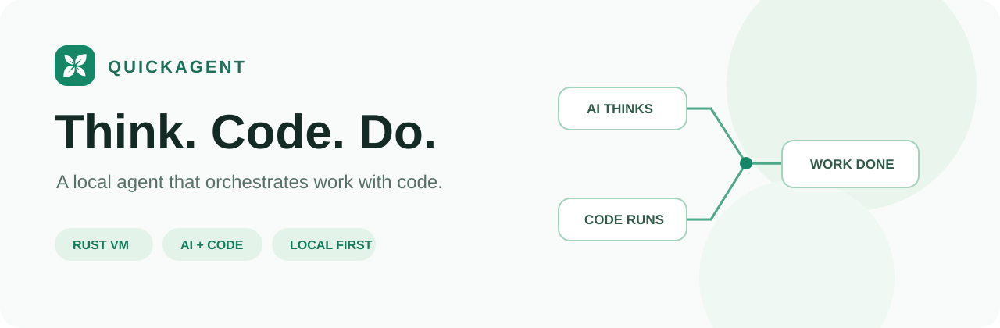

<p align="center">
  
</p>

<p align="center">
  
</p>

<h1 align="center">QuickAgent</h1>

<p align="center">
  <strong>把繁琐步骤写成代码，让 AI 把脑力留给理解、判断与创造。</strong>
</p>

<p align="center">
  
  
  
  
</p>

<p align="center">简体中文 | <a href="README.en.md">English</a> | <a href="docs/architecture-v2.md">架构设计文档 v2</a></p>

---

## 为什么做 QuickAgent？

大多数 Coding Agent 还在用“一来一回吐 JSON”的方式干活：读一个文件调一次模型、再读一个文件再调一次模型、跑个构建把 500 行终端噪音整坨塞进上下文——**步数碎、Token 贵、缓存碎、一不留神还退回裸 Shell `rm -rf`**。

**QuickAgent 走了一条不一样的路线：Context-as-Code v2。**

在这里，AI 不再被几十个 JSON Schema 绑住手脚，而是直接写出干净的现代 JavaScript，在 **Rust 自建的可挂起、可快照 JS 虚拟机** 里一口气把并发读文件、过滤数据、批量编辑、视觉验收与结构化测试全部编排完：

```js
// 一段代码并发读 4 个文件、按需切片、局部验收，零碎片往返
await plan.set({ steps: [
  { id: "inspect", title: "排查模块引用", status: "in_progress" },
  { id: "verify",  title: "运行结构化校验", status: "pending" },
]});

const [a, b] = await Promise.all([
  io.promises.read({ path: "src/tools/tool_registry.rs" }),
  io.promises.read({ path: "src/runtime/single_agent.rs" }),
]);
a.grep(/ToolSpec/);              // 懒加载 ResourceHandle，绝不把整文件糊进上下文
const check = await verify.check({ include_tests: true });
({ ok: check.ok, errors: check.diagnostics });
```

---

## 核心亮点

### 1. Rust 自建可挂起 JS-VM + `@virtual` 隔离并发帧
- **直接写现代 JS 编排**：SWC 前端解析，内置支持 `Promise.all` 真并发、`async/await`、生成器、ES2023–ES2025 集合/分组方法（`Object.groupBy`、`Set` 集合运算、`Promise.withResolvers`、`RegExp.escape`）。
- **挂起与快照不重放**：遇到宿主 I/O 或审批时完整序列化堆与栈帧到 SQLite，恢复时从断点续跑，绝不重复执行副作用。
- **`@virtual` 虚函数并发**：把需要 AI 主观判断的子任务写成 `/** @virtual */ async function`，通过 `Promise.all` 并发执行，每个子帧只在隔离作用域里工作，完成后即释放上下文。

### 2. 为 KV-Cache 而生的上下文工程（实测 99.6%+ 缓存命中）
- **不可变前缀 + 单步临时观察区（`EPHEMERAL_PEEK`）**：历史步骤严格 Append-Only，只把当前步需要细看的内容放进末尾单步窗口，多轮迭代前缀字节级稳定。
- **懒加载 `ResourceHandle`**：大文件和大输出不直接灌进上下文，而是返回可 `.slice()` / `.grep()` / `.outline()` 的轻量句柄，同回合重复读取自动去重。
- **空闲 TTL 经济软折**：仅在服务端短时缓存自然过期（默认 10 分钟空闲）后才折叠旧轮次过程，绝不在热缓存期“自毁长城”。
- **双协议原生适配**：同时支持 OpenAI Responses API（加密 reasoning 项跨步回放）与 Anthropic Messages API（滑动 4 断点 `cache_control`、分时 CNY/USD 精确计费与实时 `ContextRing`）。

### 3. 用 69 个强类型宿主库，把裸 Shell 关进笼子
全部内置工具统一收敛在单一真相源 `ToolRegistry` 中，权限、审批、撤销与 `.d.ts` 声明自动保持一致：
- **文件与原子批量编辑（`io.*`）**：`read / list(内置 glob & 排序) / search / edit / replace(智能行号偏移定位) / apply_edits(跨文件原子预检+回滚) / delete / rename / mkdir`。
- **结构化编译与测试（`verify.*`）**：原生支持 Rust / TypeScript / Node / Go / Python，纯 `argv` 无 shell 注入，直接返回精准 `file:line:col` JSON 诊断，原始输出自动归档 `asset_id`。
- **零 Shell 前端视觉闭环（`browser.*` + `vision.*`）**：直连 Chrome DevTools Protocol，原生支持 `fill / set_viewport(亮暗主题 & 移动端视口) / scroll / screenshot(CSS 选择器局部截图)`；本地或 `/tmp` 图片可通过 `vision.register_image` 一步送入视觉评审并在对话流内联预览。
- **受控 Git 与任务进度（`git.*` + `plan.*`）**：`git.blame` 只读溯源、`git.commit / restore` 强制显式路径白名单；`plan.set / update` 实时驱动输入框正上方的哑光渐变任务进度面板，并支持 `rewind` 同步回滚。
- **四语言代码索引（`code_index.*` + `flow.*`）**：内置 Rust / TypeScript / Go / Python 符号索引与调用流分析。

### 4. 清爽的 7 大领域代码架构
整个 10.9 万行 Rust 后端已完成领域化整理，`src/main.rs` 顶部仅 7 行模块声明，主驱动 `AgentTurnRunner` 仅 236 行：

```text
src/
├── main.rs      # 入口装配（Agent HTTP :3001 + MCP :3000）
├── runtime/     # AgentTurnRunner 四大门面 + 可挂起 Rust JS-VM + @virtual
├── context/     # SQLite / 上下文窗口 / 资产归档 / 会话历史 / Rewind / 记忆
├── tools/       # ToolRegistry(69 工具) / io / git / verify / plan / browser / sandbox / 撤销引擎
├── model/       # Responses & Anthropic Messages 双协议网关 / 流式重试 / 分时计费
├── media/       # 用户附件 / 视觉工件预算压缩 / 生图与识图
├── index/       # Rust / TS / Go / Python 四语言符号索引与调用流
└── server/      # agent_service / ai_proxy / MCP / 内置与远程插件宿主
```

---

## 真实工程实战记录

以下均来自 QuickAgent **自己开发、重构并验收自己代码库**的真实运行记录（非合成基准）：

| 实战任务 | 使用模型 | 规模与耗时 | 缓存与实付成本 | 结果 |
| --- | --- | --- | --- | --- |
| **10.9 万行 Rust 三阶段自重构**<br/>（`ToolRegistry` + 四大门面 + 7 域归位） | `gpt-6.2-sol` | 3 轮 · 34.7 分钟 · 93 步 · 968 次工具调用 | **94.6%–95.3%** 命中<br/>总计 **\$3.10 USD** | 根目录 75 → 1 文件、**1,124/1,124** 单测全绿、**0 告警** |
| **多阶段工具库全栈建设**<br/>（接线守卫 + `browser` + `verify` + `plan` + `git` + `apply_edits`） | `gpt-6.2-sol` | 37.0 分钟 · 121 步 · 450 次工具调用 | **94.0%** 命中<br/>总计 **\$3.95 USD** | 净增 2,665 行前后端代码、1,117 单测全绿、真实 Chrome 亮/暗双主题视觉验收通过 |
| **全栈功能开发 + 死代码清理 + UI 打磨**<br/>（附件链路恢复、`vision.register_image`、`io.delete/rename/mkdir`、清理 1,429 行死代码、Codex 总结样式） | `deepseek-flash` | 2 小时连续实战 · 363 次请求 · 4,962 万 tokens | 稳态 **99.58%–99.83%** 命中<br/>官方账单仅 **¥2.12 CNY** | 前后端单测全绿、编译器告警 58 → 0、多轮视觉自审 2 轮收敛 |

> 实战策略小贴士：日常功能开发、前端 UI 打磨与批量清理交给 **`deepseek-flash`**（每轮 ¥0.3–¥0.7）；超大规模跨层架构手术交给 **`gpt-6.2-sol`**，两档配合兼具极致速度、质量与成本。

---

## 快速开始

### 运行 Web 版

需要 Rust、Cargo、Node.js（18+）和 npm。在仓库根目录执行：

```sh
npm --prefix frontend ci
npm --prefix frontend run build
cargo run --release
```

浏览器打开 **http://127.0.0.1:3001/agent**，在右上角设置页配置模型提供商、API Key 与默认模型即可开始对话。前端热更新开发使用 `npm --prefix frontend run dev`。

### 运行桌面版（Tauri 2）

桌面端复用同一套 React 界面与 Rust 引擎。安装 [Tauri 2 系统依赖](https://v2.tauri.app/zh-cn/start/prerequisites/)后执行：

```sh
npm --prefix frontend ci
node desktop/prepare.mjs
cargo run --manifest-path desktop/Cargo.toml
```

### 常用环境变量

| 环境变量 | 默认值 | 说明 |
| --- | --- | --- |
| `WORKSPACE_ROOT` | 当前启动目录 | 默认任务工作区根目录 |
| `AGENT_BIND` | `127.0.0.1:3001` | Web 工作台与 Agent HTTP/SSE 监听地址 |
| `MCP_BIND` | `127.0.0.1:3000` | MCP 服务监听地址（路径 `/mcp`） |
| `GROW_CONFIG_DIR` | `~/.config/grow` | 本地模型路由、密钥与生成参数配置目录 |
| `AGENT_WEB_DIR` | `frontend/dist` | 前端静态产物目录（热更新构建后刷新页面即生效） |

---

## 权限边界与安全说明

QuickAgent 提供五档细粒度权限控制（`ReadOnly` / `WorkspaceWrite` / `Ask` / `AutoReview` / `FullAccess`）：
- **托管文件保护与无损撤销**：所有原生文件写、重命名、批量编辑与递归删除均纳入 `workspace_changes` 变更日志，支持按轮次一键撤销，且拒绝触碰工作区外路径、工作区根与 `.git` 内部；
- **命令沙箱**：Linux 下 `WorkspaceWrite` 模式通过 **bubblewrap（`bwrap`）** 限制子进程对工作区外的写操作；Windows 当前暂无等同 OS 进程沙箱，建议优先使用受控内置库（`io` / `verify` / `git` / `browser`）并配合 `Ask` 审批模式。

---

## 文档导航

- [**架构设计文档 v2**](docs/architecture-v2.md) — **推荐先读**：当前 Context-as-Code v2 架构、7 大领域分层、四大门面类与 `ToolRegistry` 详解
- [流程语言手册](docs/agent-program.md) — JS-VM 语法范围、`@virtual` / `@module`、并发与宿主库契约
- [Agent 设计指南（演进全集）](docs/agent-design-guide.md) — 完整设计原则与细则参考
- [技能插件包接口](docs/skill_packages.md) — 外部技能包与自定义宿主库扩展方式
- [桌面端构建说明](desktop/README.md) — Tauri 2 跨平台打包指南
- [麒麟 ARM64 工具环境](docs/kylin-arm64-environment.md) — 国产化 ARM64 Docker 工具链与部署说明

### 运行测试

```sh
cargo check --bin codex-workspace-mcp --tests
cargo test --bin codex-workspace-mcp -- --test-threads=2
npm --prefix frontend run typecheck
node --test frontend/tests/chat-process.test.mjs frontend/tests/file-link.test.mjs
```

---

## 致谢

QuickAgent 的架构演进、测试体系与界面打磨在 **Google Gemini（Antigravity）**、**DeepSeek（DeepSeek Flash）**、**OpenAI Codex** 与 **Claude** 的协同辅助下完成，完整演进脉络均保存在 Git 提交记录中。
