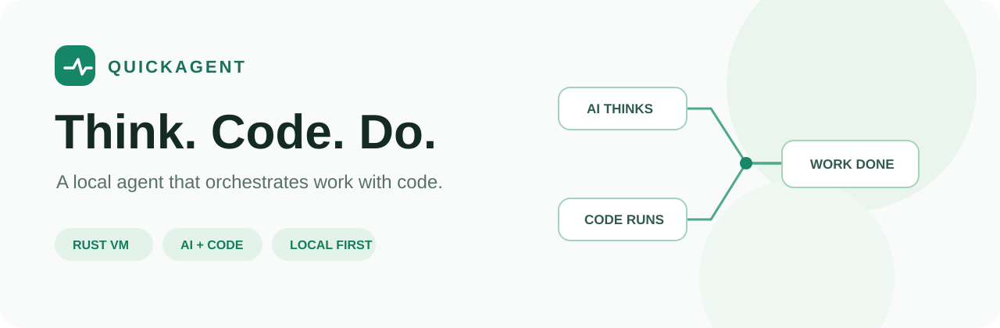
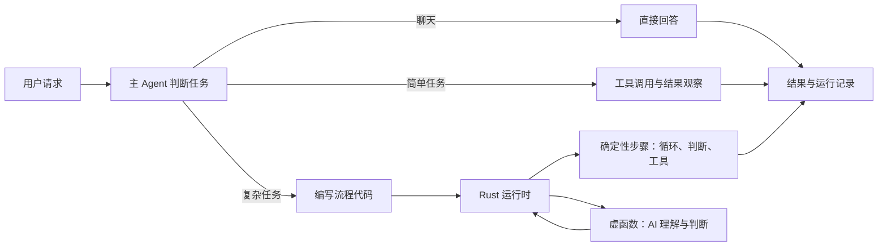

<p align="center">
  
</p>

<h1 align="center">QuickAgent</h1>

<p align="center">简体中文 | <a href="README.en.md">English</a></p>

<p align="center"><strong>用代码组织工作，让 AI 专注于理解、判断和创造。</strong></p>

<p align="center">本地 Agent · Rust 运行时 · JavaScript 流程 · 虚函数 · 按需复用</p>

---

QuickAgent 是一个面向项目工作的本地 Agent。它可以直接回答问题、使用工具完成简单任务，也可以为复杂工作编写流程代码，把循环、并发、文件操作和需要 AI 判断的步骤组织起来。

项目名中的 **Quick** 呼应了虚拟机设计对 QuickJS 的参考，也代表我们希望 Agent 在长任务中保持轻快。当前执行器由 SWC 解析并使用 Rust 自建的 JavaScript 子集虚拟机运行；它并不是完整的 JavaScript 或 QuickJS 运行时。

> 项目仍在持续开发。模型、工具和任务不同，执行效果与耗时也会不同。

## 它是怎样工作的？



**简单问题，直接解决。** 不需要为了读一个文件或回答一句话先生成程序。

**复杂工作，用代码组织。** 主 Agent 可以把确定性的步骤交给代码，把需要判断的工作交给虚函数。虚函数有自己的职责、参数和工作上下文；流程还可以使用 `async` / `await` 和 `Promise` 组织异步工作。

**完成过的流程，按需查阅。** 主流程源码由宿主保存，按项目归属，可在其他会话中查找和参考。运行记录也保存当时的源码；复用前仍需检查任务要求与项目现状。

### 一个直观的流程

```text
读取项目资料
    ↓
虚函数：理解需求并生成内容
    ↓
代码：按模板写入文件
    ↓
读取实际文件 → 检查结果 → 报告
```

在这个例子中，AI 的工作是理解和生成；写文件、读取文件和步骤顺序由程序明确表达。虚函数也可以在自己的职责范围内直接使用工具，文件是各步骤共享的实际状态。

## 核心能力

| 能力 | 说明 |
| --- | --- |
| **自然对话与工具循环** | 按任务需要读取、搜索、修改文件或运行命令，不强制每次都创建流程。 |
| **代码编排** | 使用 JavaScript 子集表达顺序、分支、循环、函数、异常处理与异步组合。 |
| **虚函数与模块** | `@virtual` 执行需要 AI 判断的职责；`@module` 按契约生成可复用的流程代码。 |
| **函数作用域** | 虚函数在独立工作上下文中执行，通过参数和声明的作用域获取所需材料，减少无关过程的传递。 |
| **项目工具** | 提供文件、搜索、命令、代码索引、浏览器和视觉分析等能力，实际可用范围取决于权限和配置。 |
| **记录与恢复** | 保存会话、工具调用、流程源码与运行事件，支持按需查看历史、文件差异和相关上下文。 |
| **网页与桌面端** | 提供 Web 界面，以及基于 Tauri 的桌面外壳。 |

了解支持的语法与限制，请看 [流程语言手册](docs/agent-program.md)。

## 实际实验

这些结果来自特定模型和任务，展示的是已观察到的运行情况，不代表所有任务都能达到相同效果，也不是与其他 Agent 的受控对照。

| 实验 | 观察结果 |
| --- | --- |
| **MiniWebpack 多轮开发** | 使用 `gpt-6-luna` high 连续推进到第 27 轮，涉及配置文件、多入口和 watch 等功能。实验统计的峰值上下文约为 22%，检查中未发现无意义重复步骤。第 24 轮模型曾说会修复测试但没有执行，第 25 轮经追问后完成。实验使用同一会话，但测试过程中曾重启服务。 |
| **50 页 HTML 幻灯片** | 一次 `gpt-6.1-terra` low 实验用时约 84 秒、调用模型 15 次；流程将内容分批并发生成，代码统一处理模板与翻页。页面检查发现部分窗口高度和标题格式仍有细节问题。 |
| **简单任务** | 一次 `gpt-6-luna` high 实测中，创建文件并读回确认约 11.55 秒，使用 4 次模型请求，没有生成流程程序。 |

**完成状态不等于验收通过。** 实验中出现过测试失败、需要继续修复和输出细节问题；项目关注的是让问题可观察、可继续处理，而不是假定每次运行都正确。

## 快速开始

### 运行 Web 版

需要 Rust、Cargo、Node.js 和 npm。在仓库根目录执行：

```sh
npm --prefix frontend ci
npm --prefix frontend run build
cargo run
```

打开 **http://127.0.0.1:3001/agent**，在设置页面配置模型提供商、密钥与主 Agent 模型。前端开发模式使用 `npm --prefix frontend run dev`，默认代理到本地 Agent 服务。

### 运行桌面版

桌面端复用 Web 界面与 Rust Agent，使用 Tauri。Windows 需要 MSVC 构建工具和 WebView2；Ubuntu 需要 WebKitGTK 等系统依赖。安装 [Tauri 2 系统依赖](https://v2.tauri.app/zh-cn/start/prerequisites/)后，在仓库根目录执行：

```sh
npm --prefix frontend ci
node desktop/prepare.mjs
cargo run --manifest-path desktop/Cargo.toml
```

桌面开发、打包及平台说明见 [桌面端文档](desktop/README.md)。Windows 和 Ubuntu 需要分别构建和验证。

### 常用配置

| 环境变量 | 作用 |
| --- | --- |
| `WORKSPACE_ROOT` | 默认任务工作区；默认使用启动目录。 |
| `AGENT_BIND` | Agent 服务监听地址；默认为 `127.0.0.1:3001`。 |
| `MCP_BIND` | MCP 服务监听地址；默认为 `127.0.0.1:3000`，入口为 `/mcp`。 |
| `DSH_HOME`、`DSH_PROFILE` | 配置目录与 profile；默认为 `~/.dsh` 和 `web`。 |
| `AGENT_WEB_DIR` | 前端构建产物目录；默认为 `frontend/dist`。 |

配置和会话保存在本地；桌面版默认使用系统应用数据目录，项目可在界面中选择。

## 权限与执行边界

QuickAgent 可以读取和修改项目文件，也可以根据权限运行命令。请根据任务选择合适的权限。

Linux 的工作区执行模式使用 **bubblewrap** 限制命令对工作区外的文件写入，需要系统安装 `bwrap` 并支持相应的命名空间；它不限制网络和文件读取。完全访问模式不使用这层隔离。Windows 当前没有等同的命令进程沙箱，桌面外壳本身也不提供该隔离。

## 文档与开发

- [Agent 设计](docs/agent-design-guide.md)：核心架构与设计原则。部分文档可能落后于代码，实际行为以当前实现为准。
- [流程语言手册](docs/agent-program.md)：虚函数、模块、并发、工具与语法范围。
- [桌面端](desktop/README.md)：Tauri 开发与打包。
- [技能插件包接口](docs/skill_packages.md)：技能和工具扩展方式。
- [模型请求诊断](docs/model_request_diagnostics.md)：排查模型连接与请求阶段问题。
- [旧版技术说明快照](README-technical.md)：保留改写前的详细说明；部分内容可能已过时。

运行项目测试：

```sh
cargo test
npm --prefix frontend run build
node --test frontend/tests/*.test.mjs
```

需要真实模型、浏览器或特定系统环境的测试须另行配置，普通测试通过不等于业务结果已经验收。

---

QuickAgent 的开发过程中使用了 Claude 和 OpenAI Codex 协助；具体变更可查看 Git 提交记录。
