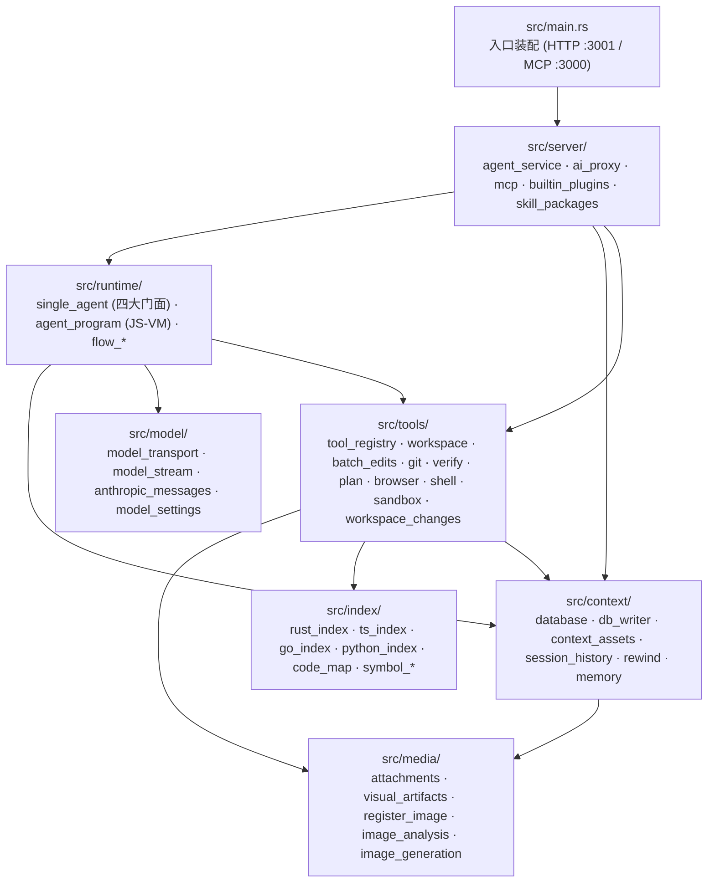
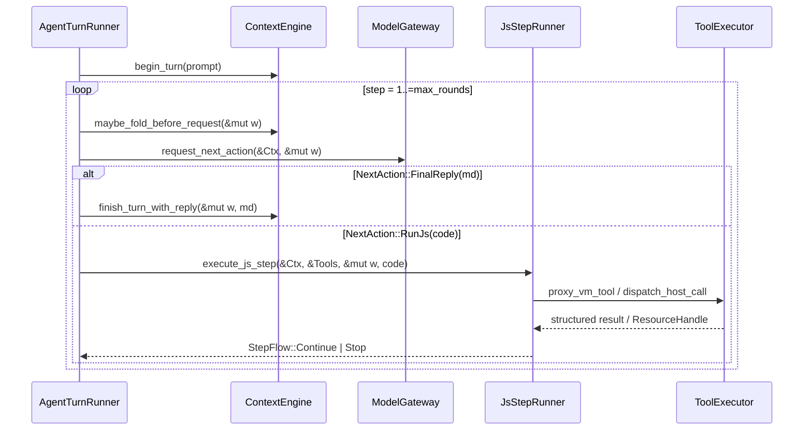

# QuickAgent 架构设计文档（Context-as-Code v2）

> 本文档对应 `feat/context-as-code-v2` 分支的**当前真实实现**，记录 QuickAgent 的核心范式、7 大领域代码分层、四大运行时门面类、可挂起 Rust JS-VM、KV-Cache 上下文工程与统一工具治理体系。

---

## 1. 核心范式：为什么是 Context-as-Code v2？

传统 Tool-Calling（JSON ReAct）Agent 在处理真实软件工程任务时存在三个结构性瓶颈：
1. **往返碎片化**：读 5 个文件、过滤 3 个字段、改 2 处代码往往要来回调用模型 6~10 次；
2. **上下文污染**：原始搜索结果、长文件和几百行构建日志全量塞入对话历史，迅速稀释注意力并推高成本；
3. **裸 Shell 权限失控**：绝大多数文件管理、编译校验、UI 验收被迫退回裸 Shell，既难审计又难撤销。

QuickAgent v2 用一套极简但高表达力的 **Context-as-Code** 协议重构了 Agent 与宿主的交互边界：
- **单一执行入口**：模型不再面对几十个臃肿的 JSON Schema 工具，系统提示词仅暴露紧凑的 TypeScript `.d.ts` 宿主库声明，模型每步要么输出一段现代 JavaScript（`run_js`），要么直接给出最终回复；
- **可挂起、可快照的 Rust JS-VM**：JS 代码由 SWC 解析并运行在自建 Rust 虚拟机中，支持 `Promise.all` 并发 I/O、ES2023–ES2025 内置能力与 `@virtual` 隔离并发子帧；遇到宿主调用即优雅挂起，由宿主执行完权限/审批/撤销追踪后再注入结果恢复；
- **高语义宿主库替代裸 Shell**：69 个内置工具按 `io / git / verify / browser / vision / plan / process / memory / session / host` 清晰分组，90%+ 日常工程操作彻底零 Shell；
- **面向 KV-Cache 设计的不可变上下文**：Append-Only 代码与回执前缀 + 单步 `EPHEMERAL_PEEK` + 懒加载 `ResourceHandle` + 空闲 TTL 经济软折，使长对话稳定维持 **94%–99.8% 前缀缓存命中率**。

---

## 2. 宏观代码架构：7 大顶层领域

`src/main.rs` 仅声明 **7 个顶层领域模块**，全仓约 11 万行 Rust 代码按职责严格分层，单向依赖清晰：

| 顶层目录 | 职责定位 | 核心模块 |
| --- | --- | --- |
| `src/runtime/` | Agent 回合驱动、JS 编译器与可挂起虚拟机 | `single_agent`、`agent_program`、`flow_libraries`、`flow_presets`、`function_frames` |
| `src/context/` | SQLite 持久化、事件流、上下文预算、资产归档、记忆与回滚 | `database`、`db_writer`、`context_assets`、`context_window`、`session_history`、`rewind`、`memory` |
| `src/tools/` | 统一工具注册表、权限审批、沙箱、文件变更撤销及各原生工具 | `tool_registry`、`workspace`、`file_edit`、`batch_edits`、`git_tools`、`verify_tools`、`plan_tools`、`browser_control`、`shell_process`、`process_sandbox`、`tool_approvals`、`workspace_changes` |
| `src/model/` | 多厂商模型路由、双协议投影、流式解析与成本遥测 | `model_transport`、`model_stream`、`anthropic_messages`、`model_settings`、`model_catalog` |
| `src/media/` | 用户附件摄入、视觉预算压缩、视觉工件、生图与识图 | `attachments`、`visual_artifacts`、`register_image`、`image_analysis`、`image_generation`、`visual_jobs` |
| `src/index/` | 四语言静态语义索引、符号查询与代码调用流 | `rust_index`、`ts_index`、`go_index`、`python_index`、`code_map`、`symbol_query`、`source_read` |
| `src/server/` | HTTP / SSE Web 服务、MCP 协议端点、内置与远程插件宿主 | `agent_service`（`db / routes / streaming / tools`）、`ai_proxy`、`mcp`、`builtin_plugins`、`skill_packages`、`remote_sessions` |

---

## 3. 运行时主循环：四大门面类串联

`src/runtime/single_agent.rs`（236 行）作为顶层协调器 `AgentTurnRunner`，将复杂回合执行解耦为 **4 个轻量借用门面类**（持有 `&Session<'a>`，避免 Rust 中巨型对象 `&mut self` 借用冲突）：

1. **`ContextEngine`（`src/runtime/single_agent/context_engine.rs`）**：负责回合窗口持久化（`Window`）、用户附件注入、空闲 TTL 软折、上下文超限强折与回合结束快照；
2. **`ModelGateway`（`src/runtime/single_agent/model_gateway.rs`）**：封装 `model_call`，处理单步模型流式请求、上下文超长自动强折重试、缓存命中率与分时费用上报；
3. **`JsStepRunner`（`src/runtime/single_agent/step_runner.rs`）**：编译并驱动单步 JS-VM 执行，处理挂起/恢复、并发 `Promise.all`、输出投影与提前 `return` 收束；
4. **`ToolExecutor`（`src/runtime/single_agent/tool_executor.rs`）**：收敛 `host_tools` 与 `tool_proxy`，统一串联权限门、审批门、托管文件 baseline 校验与变更追踪。

每轮对话使用**全新的独立 VM 实例**，回合结束即销毁内存状态；跨轮信息通过持久化对话前缀、`session.read_asset`、工作区文件与 `memory.*` 传递。

---

## 4. Rust 自建可挂起 JS-VM 与 `@virtual` 并发帧

`src/runtime/agent_program/` 实现了一套专为 Agent 编排设计的 JavaScript 运行时：
- **SWC 前端编译**：静态校验语法、宿主库作用域与未声明引用；提供精准报错与诊断提示（例如 `TS1005` 模板反引号冲突自动提示改用行数组拼接）；
- **现代 JS 能力**：支持 `async/await`、`Promise.{all, allSettled, race, any, withResolvers}`、生成器与异步迭代器、ES2023/ES2025 内置（`Object.groupBy`、`Map.groupBy`、`Array.prototype.{toSpliced, with}`、`Set` 集合运算、`RegExp.escape`）以及内置 `path / url / base64` 工具；
- **可序列化堆与协程挂起**：任何 `ActionKind::Tool` 或 `@virtual` 调用均可中断 VM、保存完整堆与帧状态到 SQLite，并在宿主完成 I/O 或子任务后精确恢复，**绝不重放已产生副作用的外部调用**；
- **`@virtual` 隔离并发帧与栈帧 GC**：可在 JS 中声明 `/** @virtual */ async function review(handle)` 并用 `Promise.all` 并发派发子帧；子帧仅可见其显式参数（支持 Pass-by-Handle 零展开传递），返回结构化结果后子帧上下文立即回收，不污染主会话。

---

## 5. 上下文工程与 KV-Cache 经济学

QuickAgent 将“缓存命中率”视为一等架构指标：

1. **不可变前缀 + 单步 `EPHEMERAL_PEEK`（`src/runtime/single_agent/context_doc/`）**
   - 历史步骤按追加式写入代码与简短 `// =>` 回执，绝不回头改写已有前缀；
   - 每次只将本步需要观察的切片/日志放入末尾单步临时区，下一步自然滑出，使多步迭代的前缀字节级完全一致。
2. **懒加载 `ResourceHandle` 与回合内透明去重**
   - 大文件读取与长输出不直接倾倒全文，而是返回轻量句柄（支持 `.slice(start, end)`、`.grep(re)`、`.outline()`、`.head()`、`.tail()` 按需分页）；
   - 同一回合重复读取未改动的文件时自动复用句柄并折叠冗余内容；超过 64 KB 的原始产物归档至 `context_assets`，可通过 `session.read_asset` 跨轮按需检索。
3. **两级经济折叠**
   - **空闲 TTL 软折**：仅当上一轮结束超过 10 分钟（`IDLE_CACHE_TTL_MS`，预期服务端短时前缀缓存已自然过期）才压缩历史轮次过程细节，避免在热缓存窗口内主动破坏缓存；
   - **超限强折**：当请求估算接近窗口预算或触发上下文长度错误时，将早期前缀源码归档为资产并自动重试。

---

## 6. 统一工具治理：`ToolRegistry` 单一真相源

`src/tools/tool_registry.rs` 用声明式 `tool_specs!` 宏统一管理全部 **69 个内置宿主工具**，一次声明即可在编译期和运行期派生 7 处下游消费点：

| 宿主库 | 代表方法 | 核心价值 |
| --- | --- | --- |
| `io` | `read / read_lines / list / search / write / edit / replace / apply_edits / delete / rename / mkdir` | `io.list` 内置 glob/时间/大小排序；`io.replace` 报错自动定位偏移行号；`io.apply_edits` 跨文件原子预检与逆序回滚 |
| `git` | `status / diff / log / blame / commit / restore`（+ 插件 `read_git / read_remote_git / sync_git`） | 显式路径白名单提交与恢复，禁用 `-A / reset --hard`，禁止修改 `.git` 内部 |
| `verify` | `check / test` | 支持 Rust / TypeScript / Node / Go / Python，纯 `argv` 无 shell 注入，返回结构化 `file:line:col` 诊断与失败列表，原始日志归档 `asset_id` |
| `browser` | `open / read / wait / diagnostics / fill / click / press_key / set_viewport / scroll / upload / screenshot(selector) / close` | 直连 Chrome DevTools Protocol，支持切亮/暗主题、移动端视口与 CSS 选择器局部截图，实现零 Shell 前端视觉验收 |
| `vision` | `register_image / analyze_images / view_image / generate_image / image_analysis_results` | 本地或 `/tmp` 截图一步入库并预算压缩，与前端 `VisualEvidenceStrip` + `ImageLightbox` 联动 |
| `plan` | `set / update` | 宿主 `task_local!` 绑定会话与轮次，单 SQLite 事务落盘并推 `plan/updated` SSE，支持 `rewind` 恢复，前端输入框上方实时展示进度面板 |
| `code_index` / `blueprint` | 符号查询 / `overview`, `read_graph`, `impact`, `verify_sync` | 四语言符号索引与入口驱动的架构蓝图 |
| `process` | `exec_command / write_stdin / kill_session / run_program / run_project_script` | 跨平台入口权限与审批、托管进程会话、超时与进程组清理 |

### 纵深安全与可恢复性
- **五档权限模型**（`ReadOnly / WorkspaceWrite / Ask / AutoReview / FullAccess`）：由 `ToolRegistry` 统一裁决；`ReadOnly` 拦截全部 `tracks_mutation == true` 的工具；`Ask / AutoReview` 对命令、浏览器、校验与 Git 写操作触发用户审批；
- **托管文件防冲突（`managed_files`）**：每次读/写记录内容哈希 baseline，若外部修改了文件则阻止盲覆写；删/移目录时递归清理子路径 baseline；
- **全量变更追踪与无损撤销（`workspace_changes`）**：单文件写、跨文件 `apply_edits`、`rename_path`（双端快照）与 `delete_path(recursive: true)`（子树快照）均纳入回合变更日志，支持一键撤销；
- **跨层接线守卫（`tool_wiring_invariants.rs`）**：测试阶段挂载真实生产 `ToolCatalogPlugin`，永久锁死“生产注册完备性 + `ReadOnly` 拦截所有变更工具 + `.d.ts` 声明完整 + 跨层策略一致”。

---

## 7. 多协议模型网关与前端体验

- **双协议模型传输（`src/model/`）**：
  - `openai-responses`：支持流式响应、加密 reasoning 项跨步回放与断流重置重试；
  - `anthropic-messages`（含 DeepSeek Flash 适配）：滑动 4 断点 `cache_control`、统一 `folded_call_id`、`usage` 归一化及分时（峰/谷）CNY/USD 实时费用核算。
- **前端工作台（`frontend/`，React + TypeScript + Vite）**：
  - 统一执行面板（`ProcessList` / `ToolRow`）：自动隐藏空思考占位行、缩略后台 Shell 会话 ID、格式化耗时与退出码、内联展示视觉证据条与灯箱大图；
  - 停靠式 `PlanProgress` 任务面板：固定于 Composer 输入框正上方，提供环形 SVG 进度标、分段哑光渐变进度条、纵向时间线轨与当前步骤焦点卡，按当前轮次隔离；
  - Codex 风格最终总结与 `<MarkdownFileLink>`：四段式清爽总结规范 + 按文件扩展名渲染语言小图标与可点击文件链接（联动展开右侧变更检查器并复制 `path:line`）；
  - 双主题美学：支持浅色 **Borderless Paper** 与深色 **Dark Ink**。
