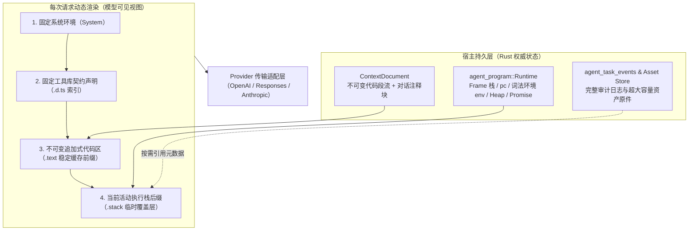

# 上下文即代码（Context-as-Code）与动态函数栈架构设计

日期：2026-11-18  
状态：待实施架构规范（实施完成后同步合入 `docs/agent-design-guide.md` 与 `docs/agent-program.md`）

> **核心一句话原则**：  
> **代码（含注释化的对话）是唯一不可变的稳定缓存前缀，函数调用栈是代码下方的临时动态后缀，运行结果是栈中的绑定与分级预览/引用。模型 ABI 是 JavaScript，宿主 ABI 是结构化运行时与 JSON。**

---

## 1. 背景与根因诊断

当前实现（以 `src/single_agent.rs` 与 `src/single_agent/program_flow.rs` 为代表）与理想设计之间存在三处根部错位：

1. **上下文权威错位**：
   - 现状把 `Window.messages: Vec<Value>`（[src/single_agent.rs](file:///home/goodtime/Documents/project/codex-workspace-mcp/src/single_agent.rs#L66)）当作主上下文权威，程序只是夹在传统 `user` / `assistant` / `tool` 消息流中的一种特殊工具调用；`request()`（[src/single_agent.rs](file:///home/goodtime/Documents/project/codex-workspace-mcp/src/single_agent.rs#L1597)）每次围绕消息数组打补丁。
2. **探索与编排被割裂为两套异构范式**：
   - 现状要求探索阶段使用 JSON Schema 工具（`read_file`、`list_dir`、`search_text` 等），熟悉后再切换到一次性 `write_program({ source })`，外加 `handoff_step`、`read_asset` 收拾上下文。
   - 若强迫模型在未知路径时早写整段程序，模型会盲猜路径或过度推理；若放开传统 JSON 工具探索，又退回传统 ReAct 循环，且 `write_program` 把 JS 源码包在 JSON 字符串里带来严重的双层转义错误（`\"`、`\\n`、正则转义）。
   - **本质上，「朴素探索循环」本来就是像 Chrome DevTools Console 一样逐行写代码**（例如 `const files = io.list({ path: "." });`），看清结构后顺势写出函数与循环跑批处理——两者只是单次提交代码段的长短不同，根本不该分成两套机制。
3. **历史 Console 模式的遗留缺陷**：
   - `2c68378` 之前短暂存在过持久 `console` 字段，但当时：(a) 仍套在 `write_program` JSON 工具壳里并与直接 JSON 工具并存；(b) 旧版 `InspectOptions::scope()` 将字符串截断为 **48 字符 / 总长 280 字符**，导致模型执行 `const evidence = io.read("xxxx.js")` 后根本看不见文件内容；(c) 旧版 `Runtime::append_cell` 在语句抛错中断时会把未完成初始化的 `let`/`const` 变量永久留在暂时性死区（TDZ），且禁止跨单元重声明同名变量，导致后续修复段无法落笔。

本设计在不推翻现有 SWC + Rust 虚拟机（`src/agent_program`）的前提下，彻底替换上下文的权威表示、模型与宿主的交互协议、以及函数作用域与上下文缓存的协同方式。

---

## 2. 总体两层架构

系统严格拆分为**模型可见的拍平代码文档**与**宿主持有的结构化运行时**两层：



### 2.1 职责边界

- **宿主保存结构化运行时，绝不把运行时状态伪装成源码**：
  - 完整对象、大字符串、数组、闭包引用、循环游标、`pc`、挂起的 `Action` 和 `Promise` 状态继续由 `agent_program::Runtime`（[src/agent_program/runtime.rs](file:///home/goodtime/Documents/project/codex-workspace-mcp/src/agent_program/runtime.rs#L111)）与 `Heap`（[src/agent_program/heap.rs](file:///home/goodtime/Documents/project/codex-workspace-mcp/src/agent_program/heap.rs#L142)）原生持有。
  - **严禁**把运行结果回写成 `const evidence = "完整原始文件内容";` 插进代码区，也**严禁**用源码内联 `@result` JSDoc 注释把运行数据永久焊死在源码中间（那会同时破坏函数退栈释放与 Prefix KV Cache）。
- **`Window.messages` 退化为纯传输适配产物**：
  - 数据库与内存中的上下文权威改为 `ContextDocument` + `Runtime` 快照；`request()` 在发送网络请求前将四段式视图打包为对应 provider 所需的消息壳（如 `[system, user]`），模型请求中**不再发送任何 JSON Schema 业务工具列表（`tools` 字段为空/省略）**。
- **JSON 退居宿主内部 ABI**：
  - 模型只写普通 JS 调用（如 `const evidence = io.read({ path: "xxxx.js" });`），VM 将库方法调用降级为现有的 `ActionKind::Tool`（[src/agent_program/runtime.rs](file:///home/goodtime/Documents/project/codex-workspace-mcp/src/agent_program/runtime.rs#L246)），Rust 宿主内部继续复用现有 JSON Schema 校验、权限检查、沙箱与 `execute_call` 执行管线。

---

## 3. 模型可见上下文：四段式缓存友好布局

模型每次请求收到的上下文固定为严格有序的四段。前两段在会话内恒定不变，第三段**只追加、永不回写**，第四段位于最底部、随每步执行动态替换并在函数返回时自动清空：

| 段落顺序 | 名称 | 生命周期与可变性 | KV Cache 行为 |
| --- | --- | --- | --- |
| **第 1 段** | 固定系统环境 | 会话级恒定（角色职责、输出协议、运行环境与沙箱说明；剔除时间戳等抖动字段） | 100% 稳定命中 |
| **第 2 段** | 固定库声明头 | 会话权限内恒定（内置静态库 `.d.ts` 核心签名 + 可 `require` 动态库/技能索引） | 100% 稳定命中 |
| **第 3 段** | **不可变代码区（`.text`）** | **只追加（Append-Only）**：含 `// @user` 用户原话、已提交 `CodeSegment` 原始源码、`// @reply` 最终答复 | **跨步、跨函数、跨轮持续命中前缀缓存** |
| **第 4 段** | **活动执行栈区（`.stack`）** | **临时后缀（Ephemeral Overlay）**：当前调用栈帧、捕获变量、局部绑定分级预览、最近一步求值观察/错误 | 仅尾部重算；子函数返回即整体清除 |

### 3.1 为什么采用「固定代码区在上 + 临时函数栈在下」？

1. **避免结果回写破坏缓存与重放语义**：如果先写 `result pending` 再改写为 `result fulfilled`，或者在函数结束后从源码中间删掉旧结果，该位置之后的全部代码 token 都会前移，导致 Prefix KV Cache 大面积失效。
2. **保证代码阅读连贯性与作用域回收同时成立**：
   - 探索时一行一行写代码，每步新增的代码段直接追加在第 3 段末尾，前序所有代码字节完全不变；
   - 当模型写出一整段函数并进入需要 AI 介入的子栈（如 `@virtual` 虚函数或交互断点帧）时，**上方第 3 段代码纹丝不动**，第 4 段在底部挂出该子函数的栈帧（含实参与捕获的外部变量）；
   - 子函数一旦 `return`，属于该子函数的整个栈后缀（含其局部大文本预览与中间试探步骤）在下一步请求中**整体清空**，模型请求前缀瞬间回到第 3 段代码末尾，既释放了上下文空间，又保留了主代码区的完整缓存命中。

### 3.2 多轮对话在代码区中的统一注释表示（禁用 `/** ... */`，统一用 `//`）

整场多轮会话在逻辑上就是**同一份不断生长的 `.js` 代码文档**。为了让用户提问与模型最终回答也自然留在第 3 段不可变代码区中，同时保证整份文档从第一行到最后一行都是合法的 JavaScript：

- **硬性语法约束：对话块一律由宿主格式化为 `//` 单行注释块，严禁使用 `/** ... */` 块注释承载用户消息或最终回答。**
  - **原因**：在 JavaScript 词法中，`/* ... */` 不支持嵌套且没有任何方式转义 `*/`。一旦用户问题或编程回答中出现常见的 Glob 路径（如 `src/**/*.ts`，其中的 `**/` 含有 `*/`）或包含 `/* 注释 */` 的代码示例，块注释会当场提前闭合，导致后续文本炸出语法错误；且 JSDoc 每行前导 `*` 极易破坏 Markdown 列表与代码块缩进。
  - **规则**：使用 `// @user` 与 `// @reply` 头标记，正文每行由宿主自动冠以 `// `（空行写为 `//`）。去掉行首 `^// ?` 即可字节级无损还原原始文本。

### 3.3 模型上下文实际渲染形态示例

```js
// ============================================================================
// [Code Document — Immutable Append-Only History]
// ============================================================================

// @user
// 帮我排查 `src/**/*.ts` 里 login 接口在 token 过期时为什么返回 500 而不是 401，并修复。

/* [seg c1 | frame main#0] */
const hits = io.search({ query: "TokenExpiredError", glob: "src/**/*.ts" });

/* [seg c2 | frame main#0] */
const targetPath = hits.matches[0].path;
const snippet = io.read_lines({ path: targetPath, start_line: 70, end_line: 115 });

/* [seg c3 | frame main#0] */
io.edit({
  path: targetPath,
  old_text: "return res.status(500).json({ error: String(err) });",
  new_text: "if (err.name === 'TokenExpiredError') return res.status(401).json({ error: 'token expired' });\n  return res.status(500).json({ error: String(err) });"
});
const testRun = process.run_readonly({ cmd: "npm test -- auth.test.ts" });
```

紧接在不可变代码区下方，渲染当前活动执行栈区（非可执行源码，仅供模型观察当前运行态）：

```text
// ============================================================================
// [Active Execution Stack — Ephemeral Runtime Projection (DO NOT copy syntax)]
// ============================================================================
active_stack:
  frame main#0 [status: idle_after_segment, last_segment: c3]
    older_locals (live on VM heap; manipulate directly in JS):
      hits       -> Object { total: 1, matches: Array(1) } [live in JS binding: hits]
      targetPath -> "src/auth/login.ts"
      snippet    -> Object { path: "src/auth/login.ts", start_line: 70, end_line: 115, content: String(1640 chars) } [live in JS binding: snippet]
    last_step_effects (c3):
      e1: io.edit({ path: "src/auth/login.ts", ... }) -> fulfilled
      e2: process.run_readonly({ cmd: "npm test -- auth.test.ts" }) -> fulfilled
    last_step_bindings (c3):
      testRun -> {
        exit_code: 0,
        running: false,
        stdout: "PASS src/auth/login.test.ts (4 tests)\n",
        stderr: ""
      } [live in JS binding: testRun]
```

当模型确认 `testRun.exit_code === 0` 并输出最终 Markdown 答复后，该临时栈清空，答复自动转存进第 3 段代码区：

```js
// @reply
// 已定位并修复（排查范围 `src/**/*.ts`）：
// - **原因**：`src/auth/login.ts` 的异常兜底分支未区分 `TokenExpiredError`，统一返回了 500。
// - **修复**：对 `TokenExpiredError` 单独返回 `401`，并通过 `npm test -- auth.test.ts`（4 个用例全部通过）。
```

---

## 4. 模型输出协议（方案 A：`<run>` 执行段 + 原生 Markdown 答复）

移除 `write_program`、`read_file` 等全部 JSON Schema 工具后，模型每步输出均为普通文本流，通过单一专用标签 `<run>...</run>` 严格区分「送入 VM 执行的代码」与「面向用户的最终回复」：

### 4.1 两种合法的模型单步响应

1. **执行代码步（Code Submission）**：
   - 模型输出包裹在 `<run>` 与 `</run>` 之间的**零转义原生 JavaScript**：
     ```xml
     <run>
     const evidence = io.read({ path: "xxxx.js" });
     </run>
     ```
   - 宿主提取 `<run>...</run>` 内部原文（不做任何 JSON 反序列化转义），作为新 `CodeSegment` 编译并在当前活动栈帧执行，更新运行时与底部执行栈后缀，进入下一步循环。
2. **最终回复步（Final User Reply）**：
   - 当模型已根据已有知识或执行栈中的真实结果得出结论时，**不输出 `<run>`**，直接输出面向用户的原生 Markdown 正文（其中包含任意 ```` ```js ````、```` ```ts ```` 示例代码块、`src/**/*.ts`、反引号等均完全安全，宿主绝不执行普通 Markdown 代码块）。
   - 前端将该原生 Markdown 实时展示给用户；本轮结束时，宿主清空本轮临时执行栈，并将该回复按每行加 `// ` 的格式追加到 `ContextDocument` 的 `// @reply` 块中。

### 4.2 硬性防抢跑与边界校验规则

1. **严禁同轮混写 `<run>` 与用户回复（`MIXED_RUN_AND_REPLY`）**：
   - 在主帧（`main#0`）中，若模型同一次回复在 `<run>...</run>` 之外还带有非空白正文（例如先写“我已经修好并通过测试了”再附 `<run>`，或在 `<run>` 后直接写结论），此时 `<run>` 尚未执行，任何结论都属于未验先答的幻觉。
   - **宿主处理**：整条响应判为协议错误（`executed: false`），不执行 `<run>`，不向用户展示正文，在执行栈后缀中附加明确诊断：`MIXED_RUN_AND_REPLY: Output ONLY <run>...</run> when executing code; write your user-facing reply ONLY in a subsequent turn after inspecting the execution result.`。
   - 唯一允许在 `<run>` 内部携带的说明是标准 JS 注释（`// ...`），它会随代码段一起保存在不可变代码区中。
2. **单次响应只允许一个 `<run>...</run>` 块**：出现多个 `<run>` 块时拒绝执行（`executed: false`），要求合并为一个连续代码段提交。
3. **输出截断保护（Output Truncation）**：
   - 若流结束原因为 `length`，或存在开标签 `<run>` 却缺失闭合标签 `</run>`：整段代码**绝不执行**（`executed: false`），保留截断统计并复用现有 `cut_off_advice`（区分是 `reasoning` 思考耗尽了输出上限，还是代码段本身过长），提示模型缩短思考或拆小代码段重新提交。
   - 若不含 `<run>` 的纯 Markdown 回复因 `length` 截断，同样追加 `REPLY_TRUNCATED` 提示模型从断点续写，不把半截回复当作终局。
4. **流式输出（Streaming UI）前瞻门控**：
   - 模型开始吐出 `content` 时，宿主只需缓冲前 **5 个非空白字符**：
     - 若前缀匹配 `<run`（如 `<run>`、`<run\n`）：进入**代码流模式**——不向前端聊天消息气泡发送 `assistant/delta` 文本（遵守「用户看到的是话，不是代码」），而是发送代码段流式进度事件（字符数/当前帧 id）供流程图状态展示。
     - 若前 5 个非空白字符不匹配 `<run`：立即进入**用户回复流模式**——释放已缓冲字符并继续零延迟推送 `assistant/delta` 给聊天界面；若后续流中途意外出现 `<run>`，立即触发 `MIXED_RUN_AND_REPLY` 撤回本步未完成气泡并转入重试。
5. **跨步推理（Reasoning）落点**：
   - 在拍平文档架构下，不依赖跨步回传历史 `assistant` 消息中的隐式思维链（OpenAI `/responses` 单步内正常使用推理，跨步意图由代码承载）。系统提示词明确引导：**需要跨步保留的假设、分支原因或步骤意图，直接写成简短的 `//` 代码注释**，随代码段沉淀在稳定缓存前缀中。

---

## 5. 运行数据的三层生命周期（VM Heap vs 执行栈预览 vs 资产库）

**核心铁律：在当前函数帧存活期间，变量的真实完整值本来就在 Rust VM 的 `Heap` 中；模型对已绑定变量做切片、正则匹配、行数统计、字段提取时，直接写普通 JavaScript 操作该变量即可，严禁强迫模型对存活变量绕道调用 `read_asset`。**

数据按职责分为三层：

```text
┌──────────────────────────────────────────────────────────────────────┐
│ 第一层：VM Heap（src/agent_program/heap.rs）                         │
│   保存当前活动栈帧可访问的完整 JS 值（字符串、数组、对象、闭包）       │
│   例：evidence.content.split("\n").slice(19, 40).join("\n") 直接内存算│
├──────────────────────────────────────────────────────────────────────┤
│ 第二层：Execution Overlay（模型请求底部的临时栈预览）                 │
│   按绑定新旧与体积分级展示，防撑爆模型窗口，同时标明可用 JS 变量名     │
├──────────────────────────────────────────────────────────────────────┤
│ 第三层：Asset / Event Store（SQLite & 磁盘资产）                     │
│   保存超出 VM 堆预算的超大原始输出，以及已退栈销毁帧的历史归档证据     │
└──────────────────────────────────────────────────────────────────────┘
```

### 5.1 第二层（Execution Overlay）的分级展示规则

必须彻底废弃旧版 `InspectOptions::scope()` 的 48 字符硬截断，改为区分**「刚完成代码段产生/更新的绑定（`last_step_bindings`）」**与**「同帧更早代码段留下的绑定 / 外部捕获绑定（`older_locals` / `captures`）」**：

#### A. 刚执行完代码段的新绑定或裸表达式求值结果（`last_step_bindings` / `last_expr`）

模型写下 `const evidence = io.read({ path: "xxxx.js" })` 的直接目的就是观察它，因此最新一步的新增/修改绑定采用**三档容量分级**：

1. **小结果（序列化后 `<= 16,000` 字符，且总计不超过单步预算 `48,000` 字符）**：
   - **完整内联显示**（保留真实换行或清晰多行文本展示），让模型一步看清刚读到的代码段、目录列表或搜索命中，无需多写一步打印代码。
2. **中等结果（`16,000 < chars <= 96,000`，仍完全驻留在 VM Heap 中）**：
   - 显示结构摘要、总字节数/总行数、前 80 行与后 20 行预览，并附上明确提示：
     `[truncated in view; full value (42,810 chars, 1,120 lines) is live in JS binding 'evidence' — filter/slice 'evidence' directly in JS]`。
   - 模型下一步可直接写 `const part = evidence.content.split("\n").slice(300, 380).join("\n");` 从内存读取，**0 次文件重读、无需 `asset_id`**。
3. **超大结果（`> 96,000` 字符但未超 VM 堆上限，或超过堆上限被转存资产）**：
   - 若仍在 VM 堆上限内（如 800 KB `cargo test` 输出）：VM 堆内的 `testRun.stdout` 依然保留完整字符串供 JS `.split("\n").filter(...)` 直接过滤；同时落盘一份 `asset_id` 归档，栈视图仅展示 `{ bytes, lines, sha256, asset_id, head_preview (2,000 chars), live_binding: "testRun" }`。
   - 若超出 VM 单次堆捕获硬上限（如 > 8 MiB `SHELL_OUTPUT_OVER_CAPACITY`）：不灌入 VM 字符串堆，返回带 `asset_id`、字节数与原因的资源错误对象，模型可用 `session.read_asset` 或分页范围工具按需流式处理。

> **裸表达式支持**：若模型像在浏览器控制台一样直接写了未赋值的表达式（如 `io.status()` 或 `evidence.content.slice(0, 500)`），VM 记录最后一个表达式语句的值，在 `last_step_bindings` 中显示为 `$_ -> <分级预览>`，并在当前帧绑定/更新 `$_`（与 Chrome DevTools Console 的 `$_` 完全一致）。

#### B. 同帧旧绑定（`older_locals`）与子帧捕获外部变量（`captures`）

- 在后续步骤（如 `c4`、`c5`）中，`c1` 留下的大对象 `hits`、`snippet` 已经展示过一次。为了不在每次栈刷新时重复预填充几十 KB 的旧变量文本，`older_locals` 与子帧 `captures` 统一渲染为**紧凑类型与结构签名**（例如 `max_depth: 2, max_items: 8, max_string_chars: 120, max_total_chars: 600`，附长度/键列表与 `[live in JS binding: name]`）。
- 如果模型在后续某一步确实需要再次肉眼查看某个旧绑定的某一部分，只需在 `<run>` 中写一行 `snippet.content` 或切片表达式，其值就会再次出现在当步 `last_step_bindings` 的 `$_` 中。

---

## 6. 函数调用栈与作用域生命周期

### 6.1 严格区分「普通确定性 JS 函数」与「`@virtual` 虚函数帧」

这是保证执行效率、避免无意义模型往返的关键边界：

| 函数类型 | 声明方式 | 执行方式 | 是否展开子栈请求模型 | 返回时回收 |
| --- | --- | --- | --- | --- |
| **普通 JS 函数 / 循环** | `function foo(...) { ... }` / `async function` / `for` / `Promise.all(ioAsync...)` | Rust VM 内部连续自动推进 `pc`，遇到 `io.*` / `process.*` 宿主直接执行并立即 `resume` VM | **否（0 次模型请求）** | VM 帧弹出，局部环境随 `Heap` GC 自动回收，中间结果从不进入模型上下文 |
| **`@virtual` 虚函数** | `/** @virtual 契约说明 */ function judge(x) {}`（或前缀快速检查 + 末尾注释挂起） | 调用点挂起父帧，上方主代码区保持冻结，底部压入子函数活动栈帧交由模型驱动 | **是（在子栈内通过 `<run>` 逐步执行直至 `return`）** | 子栈后缀整体从模型上下文清空，子帧堆与局部变量销毁，仅返回值交回父帧 |
| **交互断点帧（可选调试支持）** | 普通函数体内显式写出 `debugger;` | VM 执行到 `debugger;` 时暂停在该函数栈帧内，底部展示该帧 `locals` 与 `captures` | **是（允许在断点帧追加语句直至 `return`）** | 函数返回后子栈同样整体清空 |

### 6.2 `@virtual` 虚函数在「上下文即代码」下的统一机制

在旧架构中，主流程写 JS，而 `@virtual` 叶子却退回传统 JSON Schema ReAct 循环并靠回复裸 JSON 文本交差。在新架构中，**主帧与 `@virtual` 子帧彻底同构——子帧内部同样是写 `<run>` JavaScript 代码**：

1. **进入子帧**：
   - 假设主代码段 `c8` 调用了 `const verdict = await inspectModule(targetPath);`（其中 `inspectModule` 带有 `@virtual` 注解，且通过 `@uses config` 捕获了外层 `config`）。
   - 若 `inspectModule` 函数体开头写有确定性前置快速分支（如 `if (!targetPath) return { ok: true };`）且直接命中 `return`，则直接在 VM 内完成，不请求模型。
   - 否则进入 AI 虚函数子帧 `inspectModule#1`：
     - **上方代码区保持不动**（串口单调用可直接复用前缀缓存；独立无共享上下文调用则渲染 `[系统环境 + 子帧允许的非 shell 库声明 + inspectModule 契约与签名源码]`）。
     - **底部执行栈区**压入 `frame inspectModule#1`：
       ```text
       active_stack:
         frame main#0 [waiting: inspectModule("src/mcp.rs") at seg c8]
         └─ frame inspectModule#1 [active]
              contract: "检查模块导出边界，返回 { valid: boolean, issues: string[] }"
              params:
                targetPath -> "src/mcp.rs"
              captures (@uses):
                config -> Object { strict: true, maxExports: 12 } [live in JS binding: config]
       ```
2. **子帧内探索与完成（真正的 JS `return` / `throw`）**：
   - 模型在 `inspectModule#1` 中同样只输出 `<run>...</run>`：
     - 子步 `s1`：`<run>\nconst src = io.read_lines({ path: targetPath, start_line: 1, end_line: 120 });\n</run>`（子帧活动期间，`s1` 及 `src` 预览追加在 `inspectModule#1` 栈内，保证子帧多步之间的缓存命中）。
     - 子步 `s2`：`<run>\nreturn { valid: false, issues: ["line 88 leaks internal helper"] };\n</run>`。
   - **子帧禁令（沿用安全沙箱底线）**：
     - 严禁任何 shell 执行能力（`process.*` 在编译期与链接期均从子帧目录剥离，触发报 `VIRTUAL_SHELL_FORBIDDEN`）；
     - 严禁再声明或调用下一层 `@virtual`（单层虚函数限制 `ai_layer <= 1`，越界报 `VIRTUAL_LAYER_LIMIT`）；
     - 严禁向终端用户直接输出无 `<run>` 的 Markdown 回答（子帧服务于父函数契约，不直接跟用户对话；若收到裸文本，宿主退回 `VIRTUAL_RETURN_REQUIRED` 提示在 `<run>` 中使用 `return <value>;` 返回，唯二出口是 `return` JSON 可序列化值、用 `throw new Error(...)` / `return { $task_error: "..." }` 向父帧抛错、或调 `host.ask_user(...)` 发起用户提问）。
3. **子函数返回时的 7 步原子清理**：
   1. 校验返回值可 JSON 序列化（`Heap::ensure_json_cloneable`），若含 `"$slices"` 则按事件序号解析切片；
   2. 将返回值注入父帧 `main#0` 的挂起调用点并恢复父帧 `Runtime` 继续往下跑；
   3. 绑定到父帧目标变量（如 `verdict`）；
   4. 销毁子帧的 `locals` 局部词法环境；
   5. 销毁子帧的 `captures` 视图与子代码段队列（审计事件仍留存在 `agent_task_events` 中供回放和 UI 流程图查看）；
   6. 触发父帧必要的 `Heap` GC 回收不可达临时对象；
   7. **从模型下一次请求的执行栈后缀中彻底移除 `inspectModule#1`**——主窗口只看到 `verdict -> { valid: false, issues: [...] }`，子帧里读过的 `src` 原文零残留。

### 6.3 `Promise.all` 并发子帧

当主代码段执行 `const results = await Promise.all(files.map(f => inspectModule(f)));` 时：
- 父帧挂起在 `Promise.all` 等待集合上，宿主按并发度队列并发启动多个独立的 `inspectModule#k` 子帧任务。
- 所有并发子帧共享完全一致的只读前缀（系统提示词 + 非 shell 库声明 + 函数声明契约），最大化并发请求的 Prefix KV Cache 复用率。
- 每个子帧独立维护自己的迷你 `Runtime` 与子栈后缀直至 `return`；全部完成后结果汇总回父帧继续执行。若任一子帧发生未捕获错误且导致父 Promise 链失败，按现有规则在下一步前停止其余仍在跑的兄弟子帧，防止孤儿请求浪费额度。

---

## 7. VM 增量编译器与持久 REPL 帧改造（`src/agent_program`）

当前编译器入口 `compile_inner`（[src/agent_program/compiler.rs](file:///home/goodtime/Documents/project/codex-workspace-mcp/src/agent_program/compiler.rs#L2932)）面向一次性完整脚本设计。为支持「不可变代码段追加执行」且不重编历史代码（重编历史会导致已有函数 `pc`、闭包 ID 与挂起位置漂移），需对 `compiler.rs`、`heap.rs` 与 `runtime.rs` 做以下精确改造：

### 7.1 增量代码段编译（`compile_segment`）与挂载（`append_segment`）

1. **保留现有指令段，只编译新增 `CodeSegment`**：
   - 每个 `CodeSegment`（编号如 `c1`, `c2`, ...）作为独立入口函数（如 `<segment:c1>`、`<segment:c2>`）编译，设置 `module: true`，使其顶层语句直接运行在当前帧持久的词法环境（主帧为 `module_env`，断点/子帧为当前活动帧 `env`）之上。
   - 编译新代码段时，把当前帧词法环境中已存在的所有可见绑定名作为 `external_names` 传入 `compile_segment`，使 `c2` 可以直接读写 `c1` 留下的变量和函数。
2. **开启代码段顶层 `await` 与顶层 `return`**：
   - SWC 解析模块时默认支持顶层 `await`；在 `@virtual` 子帧的代码段中同时开启 `allow_return_outside_function: true`，使子帧中的 `return result;` 直接编译为结束当前子帧任务的 `Op::Return`。
   - 现有 `Op::Await`（[src/agent_program/runtime.rs](file:///home/goodtime/Documents/project/codex-workspace-mcp/src/agent_program/runtime.rs#L2436)）已遵循 ECMAScript 规范支持 `await` 非 Promise 值原样返回——因此无论模型写同步外观的 `const x = io.read(...)` 还是 `const x = await io.read(...)` 均完全合法、零报错。
3. **放宽增量单元的 `uncalled_functions` 检查**：
   - 一次性程序中「声明了函数却未调用」是编译错误（[src/agent_program/compiler.rs](file:///home/goodtime/Documents/project/codex-workspace-mcp/src/agent_program/compiler.rs#L2885)）；但在持久 REPL 帧中，模型完全可能在 `c2` 先定义辅助函数 `function parseHeader(text) { ... }`，再在 `c3` 调用它，或在 `c2` 定义 `main()` 却忘了调。
   - **调整规则**：在增量代码段中，声明顶层普通函数或 `@virtual` 函数自动绑定进持久 `module_env` 供本段及后续代码段调用，不再因本段未立即调用而报编译错误；但若整个代码段**仅仅声明了一个名为 `main` / `run` 的函数且本段没有任何顶层执行语句**，则在 `ExecutionOverlay` 的提示栏给出温和提醒：`Defined function 'main' in scope (not yet called; call main() in the next segment to execute it).`。

### 7.2 修复历史 `append_cell` 的两大作用域死锁问题

1. **未完成初始化的暂时性死区（TDZ）异常回滚**：
   - 在 `append_segment` 将本代码段新增的 `lexical`（`let` / `const` / `class`）名字预注册进 `Environment.uninitialized` 时，记录本段新增集合 `segment_tdz_names`。
   - 若本代码段在执行中途因未捕获异常、用户停止或资源超限而中止，宿主在收尾该段时遍历 `segment_tdz_names`：**凡仍处于 `uninitialized` 状态（即声明语句尚未成功跑完赋值）的名字，一律从 `Environment.bindings` 和 `Environment.uninitialized` 中移除**。已成功完成初始化的绑定则原样保留（供后续修复段直接复用）。
2. **V8 REPL 风格的跨代码段顶层重声明兼容**：
   - **同一代码段内部**：保持标准 JS 语法检查（同一段里写两次 `const a = 1; const a = 2;` 仍报语法错）。
   - **跨代码段之间**：若新代码段 `c5` 在同一持久帧顶层重新声明了此前代码段已存在的 `let`、`const`、`var`、`function` 或 `class` 名字（在错误修复段 `repair_for` 中极为常见，如 `c4` 写了 `const draft = ...` 后半段报错，模型在 `c5` 修正重写 `const draft = ...`），`append_segment` 允许覆盖更新该顶层绑定（若原绑定在 `readonly_bindings` 中则原地替换新绑定值并维持后续段内只读），不再抛 `Identifier '...' has already been declared`。

### 7.3 清空 JSON Schema 工具后的内置 `host` 库补齐

原本只通过直接 JSON 工具暴露给模型的循环控制与查询能力（见 [src/agent_program/libraries.rs](file:///home/goodtime/Documents/project/codex-workspace-mcp/src/agent_program/libraries.rs#L280) 的 `libraries::control`），除彻底退役的 `write_program`、`handoff_step`、`release_assets`、`define_task_body` 外，其余全部收敛进内置静态库（预注入全局命名空间，免 `import`/`require` 即可直接调用，同时兼容 `import` 与 `require`）：

| JS 调用形式 | 对应原底层能力 | 可用范围 |
| --- | --- | --- |
| `io.*` / `git.*` / `process.*` / `http.*` / `browser.*` / `vision.*` / `attachments.*` / `memory.*` | 与现有 `libraries::builtin()` 完全一致（权限与沙箱规则不变） | 主帧按会话权限开放；`@virtual` 子帧按外层引用开放且严禁 `process.*` |
| `session.*`（含 `read_session_history`、`read_asset`、`list_context_assets`、`propose_project_note` 等） | 会话历史与超限归档资产读取 | 仅主帧可用 |
| `host.contracts({ library?, tools? })` | 原 `read_tool_contracts`（查询库/插件方法的完整参数与返回契约） | 主帧与子帧均可用 |
| `host.find_methods({ query })` | 原 `find_library_methods`（按关键词检索可用库方法） | 主帧与子帧均可用 |
| `host.guide({ section? })` | 原 `read_program_guide`（按需查阅 VM 语言细节手册） | 主帧可用 |
| `host.list_skills()` / `host.read_skill({ id })` | 原 `list_skills` / `read_skill`（也可直接 `require("<skill>")` 挂载技能说明） | 主帧可用（插件专属会话仍自动预载插件说明） |
| `host.ask_user({ question, options? })` | 原 `ask_user`（抛出 `name === "WaitingForUser"`、`code === "WAITING_FOR_USER"` 的标准 JS 错误沿调用栈上抛） | 主帧与 `@virtual` 子帧均可用 |
| `previous.resume()` | 恢复本轮插嘴暂停或上一轮 `NEEDS_USER` / 手动停止保留的程序帧 | 仅当存在可恢复挂起程序时向主帧发布 |

---

## 8. 错误恢复、外部副作用边界、暂停与高水位检查点

### 8.1 代码段状态机与不可变修复四原则

每个提交的 `CodeSegment` 拥有稳定递增 ID（`c1`, `c2`, ...），**一旦进入记录，源码永远不可回写**。模型和宿主严格区分以下 7 种状态：

| 状态 (`SegmentStatus`) | `executed` | 含义与恢复规则 |
| --- | --- | --- |
| `source_rejected` | `false` | 语法错误、类型/未声明标识符编译诊断、或 `MIXED_RUN_AND_REPLY` / 输出截断。**零工具副作用**。被拒代码不进入第 3 段正式代码流（或仅留存在当前错误提示后缀中，修正通过后不污染干净代码前缀），模型直接提交修正后的代码段即可安全重达原意图。 |
| `running` | `true` | 当前帧正在 VM 内推进。 |
| `waiting_for_tool` | `true` | 已发出宿主工具或子帧调用，等待回执（崩溃恢复锚点）。 |
| `completed` | `true` | 代码段正常跑完，产生的绑定留在当前帧堆中，结果预览展示在栈后缀。 |
| `failed_after_effect` | `true` | 代码段运行中途抛出未捕获异常（此前可能已完成若干工具调用或变量绑定）。**已执行的代码段留在第 3 段不可变代码区中并标注段末中断位置**；底部栈后缀明确列出 `completed_effects`（已成功的写入/命令收据）与 `error`。模型只能追加新代码段 `c_{k+1}` 从当前真实状态继续或修复，**宿主绝不重跑 `c_k` 已执行过的语句**。 |
| `effect_unknown` | `true` | 进程崩溃或用户强制停止切断了正在执行的外部副作用操作，回执未知。底部栈后缀标明被切断的操作，模型追加的第一段恢复代码必须先读取/核验外部实际状态（如 `io.read` / `git.status`），再决定是否补做写入。 |
| `blocked_by_user` | `true` | 触发用户插嘴暂停、权限审批拒绝或 `NEEDS_USER` 障碍。整个运行时帧在安全点冻结保存，交由用户处理或由后续代码段通过 `await previous.resume()` 恢复。 |

#### 运行时错误的实际流转示例

假设 `c4` 执行：
```js
/* [seg c4 | frame main#0] */
io.write({ path: "report.md", content: draft });
const check = io.read({ path: "report.md" });
const heading = check.content.match(/^#\s+(.+)$/m)[1]; // 若无一级标题，此处抛 TypeError!
```
1. `io.write` 与 `io.read` 已真实完成，`check` 已成功绑定在 `main#0` 的 VM 堆中；第 3 行抛 `TypeError: Cannot read properties of null (reading '1')`。
2. `c4` 标记为 `failed_after_effect`（保留在代码区），`heading` 从 TDZ 回滚解锁。
3. 底部 `ExecutionOverlay` 显示：
   - `older_locals`: `draft -> String(...)`, `check -> Object { path: "report.md", content: "..." } [live in JS binding: check]`
   - `last_step_effects (c4)`: `e1: io.write("report.md") -> fulfilled`, `e2: io.read("report.md") -> fulfilled`
   - `uncaught_error (c4, line 3)`: `TypeError: Cannot read properties of null (reading '1')`
4. 模型下一步追加 `c5` 时，**直接复用已在内存里的 `check`，既不重写文件也不重读文件**：
   ```js
   const match = check.content.match(/^#\s+(.+)$/m);
   const heading = match ? match[1] : "(无标题)";
   ```

### 8.2 用户插嘴、暂停与副作用基线

- **文件并发写入基线**：完全保留 `src/single_agent/managed_files.rs` 的按任务文件基线与 `file_write_clock` 并发版本检查（外部修改保护、并行 `async @virtual` 函数整份覆盖拦截、任务自身 shell 命令改动自动同步基线）。
- **运行中用户插嘴（Interjection）**：
  - 若插嘴到达时正在运行长耗时代码段或并发 `@virtual` 子帧：宿主在各帧下一步之前安全暂停整个程序帧（移入 `resumable` 挂起槽，沿用 `paused_programs.rs`），把新用户消息作为新的 `// @user` 块追加进 `ContextDocument`，并在底部栈后缀告知挂起位置与 `previous.resume()` 可用。
  - 若插嘴到达时主帧正好处于两段代码之间的空闲态：直接把 `// @user` 追加进 `ContextDocument`，主帧带着现有 VM 堆绑定继续响应用户新要求！

### 8.3 超长会话的高水位检查点（Context Checkpoint）

「代码区只追加」在 99% 的常规与中型任务中体量极小（几十段 JS 代码通常仅几千 token，因为大体积工具输出都在临时栈后缀中随步替换或随函数弹栈释放了）。  
极端长程任务（例如连续运行数百段代码或累积数十轮长对话）当第 1–3 段总 token 逼近模型输入预算高水位（如 `>= input_budget * 4 / 5`）时，宿主执行**分段检查点（Checkpoint）**而非改写旧代码：

1. 生成一条持久化 `ContextCheckpoint` 记录（`checkpoint_id`、覆盖到的 `through_segment_id`、当前 `main#0` 堆中存活绑定的名称与类型摘要、最近一轮用户未结案请求）。
2. 检查点之后的新请求从该 `ContextCheckpoint` 头部开始渲染新的第 3 段代码区（旧代码段原封不动保存在聊天文件夹 `.js` 历史文件与数据库中，模型随时可通过 `session.read_session_history` 按行翻阅）。
3. 这样只在跨越检查点的那一刻牺牲一次缓存，平时每一步均保持 100% 前缀缓存稳定。

### 8.4 聊天文件夹产物与回退（Rewind）的一致性

- 此前由于存在「没写程序的直接 JSON 工具调用轮」，宿主不得不通过 `src/session_history/turn_record.rs` 把 JSON 调用逆向拼接成 `<name>.calls.js`。
- 新架构下，**每一轮的探索与编排本来就是原生 JS 代码段**：宿主直接按描述性文件名将本轮已执行的有效代码段（含 `// @user` 与 `// @reply`）同步写出为 `.codex-workspace-mcp/projects/<project>/chats/<chat_id>/<name>.js`（历史旧会话的 `.calls.js` 保持只读兼容）。
- 会话回退（`src/rewind.rs`）到某轮时，按轮次同步截断 `ContextDocument`、恢复/重置对应轮次的 `Runtime` 快照并清理回退轮之后派生的聊天脚本文件。

---

## 9. 核心数据结构参考（Rust 实现蓝图）

建议新增独立模块 `src/context_document.rs`（或在 `src/single_agent/context_document.rs`），将持久状态与渲染逻辑同 `single_agent.rs` 解耦：

```rust
#[derive(Clone, Debug, Default, Serialize, Deserialize)]
pub struct ContextDocument {
    pub version: u32,
    /// 按时间顺序只追加的文档条目（用户消息、已执行代码段、最终回复、高水位检查点）
    pub entries: Vec<DocumentEntry>,
    /// 单调递增的代码段计数器（生成 c1, c2, ...）
    pub next_segment_seq: u64,
    /// 最近一次被拒收（executed: false）的诊断，仅挂载在下一步临时后缀，修正通过后自动清除
    #[serde(default, skip_serializing_if = "Option::is_none")]
    pub pending_rejection: Option<RejectedSubmission>,
}

#[derive(Clone, Debug, Serialize, Deserialize)]
#[serde(tag = "kind", rename_all = "snake_case")]
pub enum DocumentEntry {
    UserTurn {
        turn: usize,
        event_seq: i64,
        text: String,
        #[serde(default, skip_serializing_if = "Vec::is_empty")]
        attachments: Vec<Value>,
    },
    CodeSegment(CodeSegment),
    AssistantReply {
        turn: usize,
        event_seq: i64,
        markdown: String,
    },
    Checkpoint(ContextCheckpoint),
}

#[derive(Clone, Debug, Serialize, Deserialize)]
pub struct CodeSegment {
    pub id: String,              // "c1", "c2", ...
    pub turn: usize,
    pub frame_id: String,        // "main#0" 或子帧 ID
    pub source: String,          // 原始未修改 JS 源码
    pub status: SegmentStatus,   // Running | WaitingForTool | Completed | FailedAfterEffect | EffectUnknown | BlockedByUser
    #[serde(default, skip_serializing_if = "Vec::is_empty")]
    pub completed_effects: Vec<EffectReceipt>,
    #[serde(default, skip_serializing_if = "Option::is_none")]
    pub failure: Option<SegmentFailure>,
}

#[derive(Clone, Debug, Serialize, Deserialize)]
pub enum SegmentStatus {
    Running,
    WaitingForTool,
    Completed,
    FailedAfterEffect,
    EffectUnknown,
    BlockedByUser,
}

#[derive(Clone, Debug, Serialize, Deserialize)]
pub struct EffectReceipt {
    pub effect_id: String,
    pub event_seq: i64,
    pub call: String,            // 如 `io.edit({ path: "src/a.rs", ... })`
    pub outcome: String,         // "fulfilled" | "failed" | "unknown" | "blocked"
    #[serde(default, skip_serializing_if = "Option::is_none")]
    pub asset_id: Option<String>,
}

/// 每次请求发给模型前从 `Runtime` + 最近一段执行结果动态构建的临时后缀，不回写历史代码区
#[derive(Clone, Debug, Default)]
pub struct ExecutionOverlay {
    pub frames: Vec<FrameProjection>,
    pub pending_rejection: Option<RejectedSubmission>,
    pub paused_program_hint: Option<Value>,
}

#[derive(Clone, Debug)]
pub struct FrameProjection {
    pub frame_id: String,
    pub title: String,
    pub status: String,
    pub contract: Option<String>,
    pub captures: Vec<BindingPreview>,          // 紧凑签名预览
    pub older_locals: Vec<BindingPreview>,      // 紧凑签名预览 + live binding 标注
    pub last_step_effects: Vec<EffectReceipt>,  // 最近一段已发生副作用收据
    pub last_step_bindings: Vec<BindingPreview>,// 三档容量预览（<=16K 完整内联）
    pub uncaught_error: Option<Value>,
}
```

### 数据库存储与平滑兼容

- `agent_runtime_windows` 表中的 `Window` 结构体新增 `context_doc: Option<ContextDocument>` 与持久主帧 `repl_runtime: Option<agent_program::Runtime>`（保留旧字段 `#[serde(default)]` 以免旧任务反序列化失败）。
- `agent_task_events` 继续完整记录 `user/message`、`segment/start`（兼容或扩展 `program/start`）、`tool/call`、`tool/result`、`segment/end`、`assistant/message`，保证前端流程图（`src/frame_view.rs`）与历史浏览器（`src/session_browser.rs`）无缝工作。

---

## 10. 分阶段实施路线与验收标准

> **实施前必读约束（遵守仓库 [AGENTS.md](file:///home/goodtime/Documents/project/codex-workspace-mcp/AGENTS.md)）**：  
> - 每次编译测试前先用 `df -Pk .` 检查磁盘可用空间（低于 20 GB 立即停止并报告）。  
> - 若需对照历史提交，严禁在主工作区共享 `target/` 混编，必须解压至独立目录并设置独立 `CARGO_TARGET_DIR`，跑完保留日志后立即清理临时构建目录；严禁全局 `cargo clean` 破坏他人缓存。  
> - 遵循「先让新路径在独立模块与测试中跑通，再切换主入口，最后清理旧仪式」的无损迁移顺序。

### 阶段划分（8 步落地）

1. **Step 1：VM 增量段编译与 REPL 持久帧（`src/agent_program/`）**
   - 在 `compiler.rs` 实现 `compile_segment`（支持 `external_names`、顶层 `await`、子帧顶层 `return`、增量函数声明不误报 `uncalled_functions`）。
   - 在 `heap.rs` 与 `runtime.rs` 恢复并升级 `append_segment`：实现**未完成 TDZ 绑定异常回滚**、**跨代码段顶层 `let`/`const`/`function` 重绑定**、以及**裸表达式末尾求值记录 `$_`**。
   - 实现三档容量分级预览器 `js_value::inspect_binding`（区分 `last_step_bindings` 的 16K 完整内联 / 96K 首尾预览 与 `older_locals` 的紧凑签名）。
2. **Step 2：内置 `host` 库补齐与零 Schema 声明头（`src/agent_program/libraries.rs` & `declarations.rs`）**
   - 将 `contracts`、`find_methods`、`guide`、`list_skills`、`read_skill`、`ask_user` 接入 `host` 静态库并在 `execute_call` 联通。
   - 默认对主帧预注入常用内置库命名空间（`io`、`git`、`process`、`host`、`session`），同时保持显式 `import` / `require` 100% 兼容。
3. **Step 3：独立实现 `ContextDocument` 与 `ExecutionOverlay` 渲染器（`src/context_document.rs`）**
   - 实现 `// @user`、`/* [seg ck] */`、`// @reply` 的无损渲染（含 `*/`、反引号、代码块压力测试）与高水位 `Checkpoint` 切段逻辑。
   - 实现从 `Runtime` 活动帧提取 `FrameProjection` 的投影器，严格验证：第 1–3 段在跨步追加与子函数进出前后**前缀字节 100% 一致**。
4. **Step 4：`<run>` 输出解析器与流式前瞻门控（`src/model_stream.rs` & `src/single_agent.rs`）**
   - 实现 `<run>...</run>` 提取、`MIXED_RUN_AND_REPLY` 拦截、截断保护（`executed: false`），以及 5 字符前瞻流式门控（`<run` 走代码进度事件，非 `<run` 走实时 `assistant/delta`）。
5. **Step 5：切换主循环与 `request()` 到四段式拍平文档（`src/single_agent.rs`）**
   - 主请求不再下发 JSON Schema `tools` 数组；`request()` 从 `ContextDocument` + `ExecutionOverlay` 生成请求载荷（同时兼容 Chat Completions、`openai-responses` 与 Anthropic Messages）。
   - 打通单步探索、多行函数/循环确定性执行、编译报错修正（`source_rejected`）与带副作用运行时异常续写（`failed_after_effect`）。
6. **Step 6：打通 `@virtual` 子函数栈生命周期与并发 `Promise.all`（`src/single_agent/program_flow.rs` & `task_frames.rs`）**
   - `@virtual` 子帧统一使用 `<run>` + JS `return` / `throw` 协议；验证进入子帧时主代码区不动、底部追加子栈（含 `@uses` 捕获外部变量），`return` 后子栈及局部堆对象彻底释放。
   - 接入用户插嘴暂停、`NEEDS_USER` 阻塞、`previous.resume()` 恢复与聊天文件夹 `<name>.js` 同步落盘。
7. **Step 7：真实任务与端到端回归验收**
   - 跑通只读探索 → 代码修改 → `process.run_readonly` 跑单测验证 → 最终 Markdown 回复全链路，以及 `Promise.all` 并发 `@virtual` 扇出任务，核查请求日志中的真实 Prefix Cache 命中率。
8. **Step 8：清理退役机制并同步权威文档**
   - 移除 `write_program`、`handoff_step`、`FAMILIAR` 直接 JSON 工具路由、双模态阶段提示词与旧模块双层冗余逻辑。
   - 将本设计正式合入 `docs/agent-design-guide.md`、`docs/agent-program.md`、`prompts/single_agent.md`、`prompts/flow_environment.md` 与 `prompts/virtual_leaf.md`。

---

### 第一批核心验收用例清单（Acceptance Matrix）

实施团队在 Step 1–6 完成时，必须有自动化集成测试逐条覆盖以下 10 项不变量：

1. **单步只读与跨段内存复用**：`c1` 执行 `const evidence = io.read({ path: "a.js" });`，`c2` 执行 `const lines = evidence.content.split("\n").length;` 成功拿到行数，且期间 `read_file` 只被调用 **1 次**，无 `read_asset` 调用。
2. **大值内存直取**：`c1` 读取 40 KB 文件绑定到 `big`（栈预览显示截断摘要与 `live in JS binding: big`），`c2` 直接通过 `big.content.slice(20000, 20500)` 拿到精确内容，无需磁盘重读。
3. **跨进程重启恢复不重放**：代码段在第二个工具调用挂起时模拟宿主重启，恢复后从挂起帧 `pc` 继续，第一个已完成的工具调用绝不重复执行。
4. **普通 JS 函数零模型往返与局部释放**：提交含 10 次循环 `io.read` 的普通函数并调用，VM 在 0 次额外模型请求内跑完返回汇总对象，函数内临时大字符串从活动堆释放。
5. **`@virtual` 子栈挂载与返回清空**：进入 `@virtual` 函数执行 2 步后 `return`，执行期间上方主代码区字节不变、底部显示子栈及 `@uses` 捕获变量；返回后下一步请求中整个子栈后缀彻底消失，父帧收到返回值绑定。
6. **缓存前缀字节级稳定**：连续执行 `c1`、`c2`、`c3` 三段代码，断言第 2 次请求完整包含第 1 次请求第 1–3 段的精确字节前缀，第 3 次请求完整包含第 2 次请求第 1–3 段的精确字节前缀。
7. **`// @user` 与 `// @reply` 语法免疫**：用户消息和模型最终回复中包含 `src/**/*.ts`、`/* 块注释 */`、```` ```js ```` 代码块、`` `${x}` `` 模板语法时，归档后的代码文档仍可被 SWC 100% 无错解析，且还原文本字节无损。
8. **同轮混写拦截（`MIXED_RUN_AND_REPLY`）**：模型同一次输出同时包含说明文字与 `<run>...</run>` 时，工具调用次数为 0（`executed: false`），不向用户发出未验证正文。
9. **编译失败零副作用与 TDZ 不锁死**：`c1` 语法错被拒后无任何副作用；`c2` 在 `const x = io.write(...); const y = badCall();` 第二行抛运行时异常后，`c3` 既能读取已完成效果收据，也能重新声明 `const y = ...` 正常继续，且 `c2` 的 `io.write` 绝不重跑。
10. **零 JSON Schema 工具请求**：抓包验证发往模型服务端的请求体中不包含 `read_file`、`list_dir`、`write_program`、`handoff_step` 等任何业务工具 JSON Schema。
