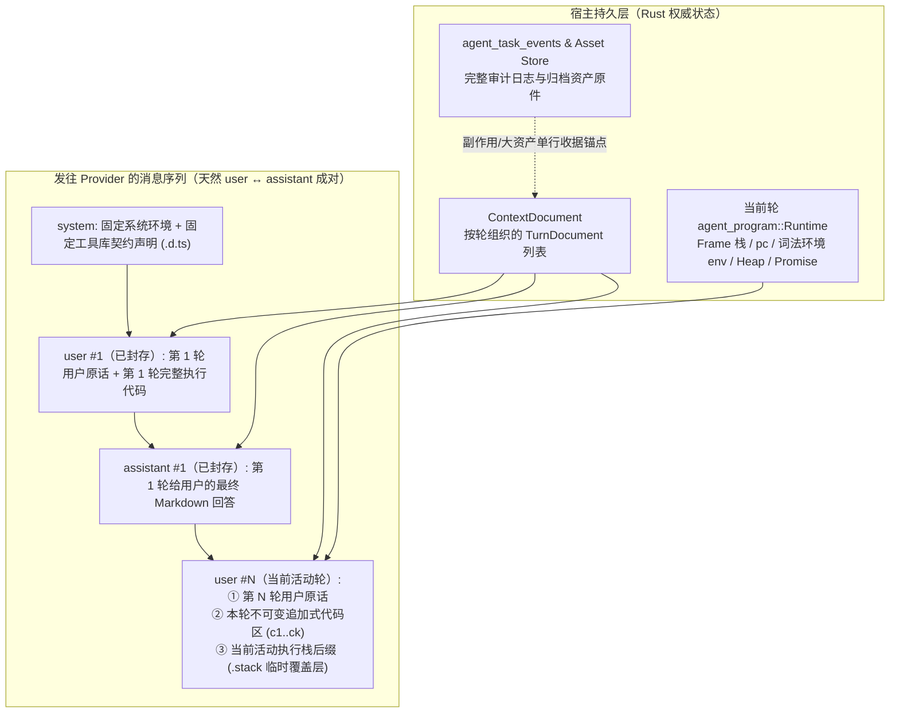

# 上下文即代码（Context-as-Code）与动态函数栈架构设计

日期：2026-11-18  
状态：待实施架构规范（实施完成后同步合入 `docs/agent-design-guide.md` 与 `docs/agent-program.md`）

> **核心原则**：  
> 1. **以轮为单位配对（`user` ↔ `assistant`），每轮强制清空重建虚拟机**：每一轮由用户发起的任务都从**完全空白的全新 `Runtime` 虚拟机**开始（零遗留变量、零遗留函数、零闭包/模块缓存残留、代码段从 `c1` 重新编号），彻底杜绝跨轮作用域污染与代码越写越多。`user` 消息承载「用户原话 + 本轮不可变追加式编排代码（活动轮底部附临时函数栈）」，本轮结束时的最终总结/答复作为原生 `assistant` 消息成对收口，并立即销毁本轮整个虚拟机实例。  
> 2. **轮内靠栈隔离，轮间靠精简摘抄回溯**：轮内代码固定在上方充当稳定缓存前缀，函数调用栈挂在下方充当临时后缀，子函数返回即清空子栈；后续轮次若需要前轮某个只读变量值或逻辑，直接从上方前轮 `user` 保留的干净代码中**按需摘抄/复用最小相关代码片段**在本轮全新 VM 中重跑拿最新值（副作用操作除外）。  
> 3. **模型 ABI 是 JavaScript，宿主 ABI 是结构化运行时与 JSON**。

---

## 1. 背景与根因诊断

当前实现（以 `src/single_agent.rs` 与 `src/single_agent/program_flow.rs` 为代表）与理想设计之间存在三处根部错位：

1. **轮内上下文被传统工具消息切碎**：
   - 现状把 `Window.messages: Vec<Value>`（[src/single_agent.rs](file:///home/goodtime/Documents/project/codex-workspace-mcp/src/single_agent.rs#L66)）中交错堆叠的 `assistant(tool_calls)` 与 `tool(result)` 当作主上下文权威，程序只是夹在其中的一种特殊工具调用；`request()`（[src/single_agent.rs](file:///home/goodtime/Documents/project/codex-workspace-mcp/src/single_agent.rs#L1597)）每次围绕这套传统工具往来打补丁。
2. **探索与编排被割裂为两套异构范式**：
   - 现状要求探索阶段使用 JSON Schema 工具（`read_file`、`list_dir`、`search_text` 等），熟悉后再切换到一次性 `write_program({ source })`，外加 `handoff_step`、`read_asset` 收拾上下文。
   - 若强迫模型在未知路径时早写整段程序，模型会盲猜路径或寻思半天；若放开传统 JSON 工具探索，又退回传统 ReAct 循环，且 `write_program` 把 JS 源码包在 JSON 字符串里带来严重的双层转义错误（`\"`、`\\n`、正则转义）。
   - **本质上，「朴素探索循环」本来就是像 Chrome DevTools Console 一样逐行写代码**（例如 `const files = io.list({ path: "." });`），看清结构后顺势写出函数与循环跑批处理——两者只是单次提交代码段的长短不同，根本不该分成两套机制。
3. **历史 Console 模式的遗留缺陷**：
   - `2c68378` 之前短暂存在过持久 `console` 字段，但当时：(a) 仍套在 `write_program` JSON 工具壳里并与直接 JSON 工具并存；(b) 旧版 `InspectOptions::scope()` 将字符串截断为 **48 字符 / 总长 280 字符**，导致模型执行 `const evidence = io.read("xxxx.js")` 后根本看不见文件内容；(c) 旧版 `Runtime::append_cell` 在语句抛错中断时会把未完成初始化的 `let`/`const` 变量永久留在暂时性死区（TDZ），且禁止跨单元重声明同名变量，导致后续修复段无法落笔。

本设计在不推翻现有 SWC + Rust 虚拟机（`src/agent_program`）的前提下，彻底统一轮内代码上下文、多轮 `user`/`assistant` 成对结构、以及函数作用域与上下文缓存的协同机制。

---

## 2. 总体架构：轮次成对 + 轮内拍平代码与动态栈

系统严格拆分为**模型可见的多轮配对代码视图**与**宿主持有的结构化运行时**两层：



### 2.1 核心职责边界

1. **多轮结构：以 `user` 为主、一轮一独立虚拟机，终局总结进 `assistant` 凑成标准对数**：
   - 严格保持大模型原生预训练最擅长的 **`user` → `assistant` → `user` → `assistant` 交替配对**。
   - **每轮强制清空重建 VM（防作用域污染与代码堆积）**：每一轮用户发起新任务时，宿主**无条件新建一个完全空白的 `Runtime` 虚拟机**（空的 `module_env`、空的 `Heap`、空的 `program.functions`、代码段序号重置为 `c1`）。上一轮声明过的变量（如 `files`、`targets`、`res`）和临时函数**绝不带入新一轮作用域**——新一轮既可以自由使用最自然的变量名而不撞名，也不会因为漏声明变量而静默误读上一轮遗留的旧文件路径。
   - **轮内（正在执行的第 `N` 轮）**：仅针对本轮任务编写最小必要代码段（`c1`, `c2`, ...），统一拍平追加在 `user #N` 消息内；当前运行结果和调用栈挂在 `user #N` 最底部。
   - **轮末收口**：模型给出面向用户的最终总结/答复时，剥离 `user #N` 底部的临时执行栈，将该答复作为原生 `assistant #N` 消息落盘，凑成一对 `(user #N, assistant #N)`，同时**彻底销毁第 `N` 轮的整个 `Runtime` 实例**。
2. **宿主保存结构化运行时，绝不把运行值伪装成源码**：
   - 当前轮存活期间，完整对象、大字符串、数组、闭包、`pc`、挂起的 `Action` 和 `Promise` 继续由 `agent_program::Runtime`（[src/agent_program/runtime.rs](file:///home/goodtime/Documents/project/codex-workspace-mcp/src/agent_program/runtime.rs#L111)）与 `Heap`（[src/agent_program/heap.rs](file:///home/goodtime/Documents/project/codex-workspace-mcp/src/agent_program/heap.rs#L142)）持有。
   - **严禁**把运行结果回写成 `const evidence = "完整原始文件内容";` 插进代码区，也**严禁**用源码内联 `@result` JSDoc 注释把运行数据焊死在代码中间。
3. **JSON 退居宿主内部 ABI，请求彻底零 `tools` Schema**：
   - 模型请求中**不再发送 `read_file`、`list_dir`、`write_program` 等任何 JSON Schema 工具定义**（`tools` 字段为空/省略）。
   - 模型只写普通 JS 调用（如 `const evidence = io.read({ path: "xxxx.js" });`），VM 将其降级为现有的 `ActionKind::Tool`（[src/agent_program/runtime.rs](file:///home/goodtime/Documents/project/codex-workspace-mcp/src/agent_program/runtime.rs#L246)），Rust 宿主内部继续复用现有 JSON 参数校验、权限检查、沙箱与 `execute_call` 管线。

---

## 3. 上下文缓存布局与跨轮代码回溯机制

### 3.1 轮内与跨轮都 100% 命中的缓存布局

对比第 `N` 轮内连续执行，以及第 `N` 轮结束切入第 `N+1` 轮时的字节序列变化：

| 位置 | 内容 | 生命周期与可变性 | Prefix KV Cache 行为 |
| --- | --- | --- | --- |
| `system` | 固定系统环境 + 固定库声明头（`.d.ts` 核心签名与可 `require` 索引） | 会话内恒定（剔除时间戳等抖动字段） | **全程 100% 命中** |
| `user #t` / `assistant #t` (`t < N`) | 历史轮次：`user #t`（用户原话 + 该轮完整纯代码）+ `assistant #t`（原生最终回答） | **永久冻结（Immutable）** | **跨轮 100% 命中** |
| `user #N` 上半部 | 当前轮：**用户原话 + 本轮已提交代码区（`c1 .. ck`）** | **只追加（Append-Only），绝不回写** | **轮内每步持续命中** |
| `user #N` 下半部 | 当前轮：**活动执行栈后缀（`active_stack`）** | **临时后缀（Ephemeral）**：每步替换；子函数返回清空子栈；**本轮结束整体剥离** | 仅尾部重算 |

> **关键缓存性质（为什么连跨轮交接都不会破坏缓存）**：  
> 因为临时栈 `active_stack` 始终位于 `user #N` 的**最末尾**，当第 `N` 轮结束、宿主剥离 `active_stack` 并追加 `assistant #N` 与 `user #(N+1)` 时，`[system .. user #N 的原话与完整代码 c1..cm]` 的字节偏移**一个字节都没有变**！这意味着不仅轮内单步探索命中缓存，连进入下一轮用户对话时，上一轮写过的所有代码依然继续命中前缀缓存。

### 3.2 多轮上下文实际渲染形态示例

```text
[system]
  (角色说明 + <run> 输出协议 + 沙箱环境 + io/git/process/host/session 库 .d.ts 签名)

[user #1]
  帮我找出 `src/routes` 下所有没加 `requireAuth` 中间件的路由文件。

  // --- Executed Program (turn-1: find-unguarded-routes.js) ---
  /* [seg c1 | frame main#0] */
  function findUnguardedRoutes(dir) {
    const allFiles = io.list({ path: dir }).entries.filter(e => e.kind === "file" && e.path.endsWith(".ts"));
    return allFiles
      .filter(f => !io.read({ path: f.path }).content.includes("requireAuth"))
      .map(f => f.path);
  }
  const unguarded = findUnguardedRoutes("src/routes");

[assistant #1]
  检查完毕，`src/routes` 下共有 2 个路由文件未挂载 `requireAuth` 中间件：
  1. `src/routes/health.ts`
  2. `src/routes/legacyWebhook.ts`

[user #2]
  除了 health.ts 以外，给刚才查出来的漏检路由补上 `requireAuth`，并跑一下路由单测。

  // --- Executed Program (turn-2, fresh VM, in progress) ---
  /* [seg c1 | frame main#0] */
  // 从第 1 轮代码按需摘抄/精简只读筛选逻辑，在本轮全新 VM 中拿最新结果
  const targets = io.list({ path: "src/routes" }).entries
    .filter(e => e.kind === "file" && e.path.endsWith(".ts") && !e.path.endsWith("health.ts"))
    .filter(f => !io.read({ path: f.path }).content.includes("requireAuth"))
    .map(f => f.path);
  const preview = io.read({ path: targets[0] });

  // === Active Execution Stack (Ephemeral — DO NOT copy syntax) ===
  active_stack:
    frame main#0 [status: idle_after_segment, last_segment: c1]
      last_step_bindings (c1):
        targets -> ["src/routes/legacyWebhook.ts"]
        preview -> {
          path: "src/routes/legacyWebhook.ts",
          content: "import { Router } from 'express';\nexport const router = Router();\n..."
        } [live in JS binding: preview]
```

### 3.3 每轮清空虚拟机后的「跨轮回溯与防膨胀」三原则

每轮结束生成 `assistant #t` 时销毁整个 `Runtime`，下一轮从空白 VM 重新起步。这样做同时解决了三个核心问题：
- **零作用域污染**：不会出现跨轮 `Identifier 'x' has already been declared`，更不会因漏写声明而静默引用到几轮前遗留的旧变量；
- **零陈旧脏读**：两轮之间用户在掌控工作区（可能手动修改文件或切换分支），清空 VM 迫使新一轮读取真实磁盘现状；
- **防止代码滚雪球堆积**：每轮只写解决当前这一轮问题所需的最小自包含代码，不背负历史轮次的死代码包袱。

当后续轮次需要前序轮次算过的某个值或写过的某段逻辑时，遵循以下三条标准规则：

1. **只读查询/过滤与辅助逻辑：从上方前轮 `user #t` 按需摘抄最小片段重跑**
   - 前序 `user #t` 中没有几十 KB 的工具输出噪音，取数逻辑与辅助函数清晰可见。
   - 模型直接在当前轮空白 VM 的 `<run>` 中**只摘抄（或微调复用）与本轮直接相关的那几行只读代码/辅助函数**重新运行一遍，既拿回反映当前最新磁盘状态的准确值，又保持本轮代码短小干净（绝不把前轮无关代码整坨照搬过来，也不让跨轮临时脚本互相隐式耦合；真正跨会话通用的流程通过项目技能库 `require("<skill>")` 沉淀）。
2. **有副作用操作或高成本外部命令：严禁为“拿旧值”重跑副作用，凭单行收据查档**
   - **硬性禁令**：前序轮次执行过的写操作（`io.write`、`io.edit`、`io.replace`）以及外部命令（`process.exec_command`、长耗时构建测试、外部变更请求），后续轮次**绝不能为了找回当时的输出而重新执行该写入或命令**。
   - 查看文件当前状态：直接 `io.read` 当前文件。
   - 查看前序轮次某次命令或大输出的原始记录：宿主在封存 `user #t` 代码段时，仅为产生了归档资产或外部命令执行的语句附上一行极短的只读收据注释，例如：
     ```js
     const build = process.run_readonly({ cmd: "cargo test --workspace" });
     // [receipt: seq=142, exit_code=101, stdout_asset="asset-8a3f" (94,210 chars)]
     ```
     后续轮次若用户追问“上一轮报错日志第 200 行写了什么”，模型直接调用 `session.read_asset({ asset_id: "asset-8a3f", ... })` 按需读取，0 副作用、0 重跑开销。
3. **历史轮代码容量收敛（防止多轮累积后上下文代码越来越多）**
   - 最近若干轮（在 `RECENT_CODE_CHARS` 预算内，如 24,000 字符）在 `user #t` 中完整保留纯代码，方便紧邻轮次直接回看与摘抄复用；
   - 更早的历史轮次或超出多轮窗口阈值（`CHAT_CHARS`，如 48,000 字符）时，按缓存友好的离散批次切段（不逐轮抖动开头）：滑出代码内联区的旧轮保留原样对话或归档脚本引用（`.codex-workspace-mcp/projects/<proj>/chats/<chat>/<name>.js`），需要追溯远古轮次细节时通过 `session.read_session_history` 按行查阅。

---

## 4. 模型输出协议（方案 A：`<run>` 执行段 + 原生 Markdown 答复）

移除全部 JSON Schema 工具后，模型每步输出均为普通文本流，通过单一专用标签 `<run>...</run>` 严格区分「送入 VM 执行的代码」与「结束本轮并写入 `assistant` 消息的最终答复」：

### 4.1 两种合法的模型单步响应

1. **执行代码步（Code Submission）**：
   - 模型输出包裹在 `<run>` 与 `</run>` 之间的**零转义原生 JavaScript**：
     ```xml
     <run>
     const evidence = io.read({ path: "xxxx.js" });
     </run>
     ```
   - 宿主提取 `<run>...</run>` 内部原文（不做任何 JSON 反序列化转义），作为新 `CodeSegment` 编译并在当前轮 `Runtime` 活动栈帧执行，把源码追加进当前 `user #N` 代码区、刷新底部 `active_stack` 后缀，继续下一轮模型请求。
2. **最终回复步（Final Assistant Reply）**：
   - 当模型已根据已有知识或当前 `active_stack` 中的真实结果得出结论时，**不输出 `<run>`**，直接输出面向用户的原生 Markdown 正文（其中包含任意 ```` ```js ````、```` ```ts ```` 示例代码块、`src/**/*.ts`、反引号、`/* 注释 */` 等均完全天然合法，宿主绝不执行普通 Markdown 代码块）。
   - 前端实时流式展示该回复；流结束后，宿主剥离 `user #N` 的临时栈后缀、释放本轮 `Runtime` 堆、将该 Markdown 原样存为 `assistant #N` 消息，本轮结束。

### 4.2 硬性防抢跑与流式门控规则

1. **严禁同步混写 `<run>` 与用户回复（`MIXED_RUN_AND_REPLY`）**：
   - 在主帧（`main#0`）中，若模型同一次输出在 `<run>...</run>` 之外还带有非空白说明正文（例如先向用户承诺“已修复并通过测试”再附 `<run>`），此时 `<run>` 根本尚未进 VM 执行，属于典型的未验先答幻觉。
   - **宿主处理**：整条响应判为协议错误（`executed: false`），不执行 `<run>`，不向用户交付正文，在底部栈后缀附加诊断：`MIXED_RUN_AND_REPLY: Output ONLY <run>...</run> when executing code; output your final Markdown reply ONLY in a separate step after inspecting execution results.`。
   - 唯一允许在代码步保留的文字是写在 `<run>` 内部的 JS 注释（`// ...`），它会随代码段留在 `user #N` 的稳定代码区中。
2. **单次响应只允许一个 `<run>...</run>` 块**：出现多个 `<run>` 块时拒绝执行（`executed: false`），要求合并为一个连续代码段提交。
3. **输出截断保护（Output Truncation）**：
   - 若流结束原因为 `length`，或存在开标签 `<run>` 却缺失闭合标签 `</run>`：整段代码**绝不执行**（`executed: false`），复用现有 `cut_off_advice`（区分是 `reasoning` 思考耗尽了输出上限，还是代码段本身过长），提示模型缩短思考或拆小代码段重新提交。
   - 若不含 `<run>` 的最终 Markdown 回复因 `length` 截断，追加截断续写提示，不把半截回复当作终局封存。
4. **流式输出（Streaming UI）5 字符前瞻门控**：
   - 模型开始吐出 `content` 时，宿主仅缓冲前 **5 个非空白字符**：
     - 若前缀匹配 `<run`（如 `<run>`、`<run\n`）：进入**代码流模式**——不向前端聊天消息气泡发送 `assistant/delta`（遵守「用户看到的是话，不是执行代码」），而是发送代码段流式进度事件供流程图状态展示。
     - 若前 5 个非空白字符不匹配 `<run`：立即进入**用户回复流模式**——释放已缓冲字符并继续零延迟推送 `assistant/delta` 给聊天界面；若流中途意外出现 `<run>`，立即触发 `MIXED_RUN_AND_REPLY` 丢弃未完成气泡并重试。
5. **跨步推理（Reasoning）落点**：
   - 轮内各步由于统一追加进 `user #N` 代码区，不保留前几步的中间 `assistant` 隐式思维链消息。系统提示词明确引导：**需要跨步或跨轮保留的假设、分支原因或步骤意图，直接写成简短的 `//` 代码注释**，沉淀在稳定缓存前缀中。

---

## 5. 轮内运行数据的三层生命周期（VM Heap vs 执行栈预览 vs 资产库）

**核心铁律：在当前轮及当前函数帧存活期间，变量的真实完整值本来就在 Rust VM 的 `Heap` 中；模型对已绑定变量做切片、正则匹配、行数统计、字段提取时，直接写普通 JavaScript 操作该变量即可，严禁强迫模型对存活变量绕道调用 `read_asset`。**

```text
┌──────────────────────────────────────────────────────────────────────┐
│ 第一层：VM Heap（src/agent_program/heap.rs，随帧/轮生命周期释放）    │
│   保存当前活动栈帧可访问的完整 JS 值（字符串、数组、对象、闭包）       │
│   例：evidence.content.split("\n").slice(19, 40).join("\n") 直接内存算│
├──────────────────────────────────────────────────────────────────────┤
│ 第二层：Execution Overlay（当前轮 user #N 底部的临时栈预览）          │
│   按绑定新旧与体积分级展示，防撑爆模型窗口，同时标明可用 JS 变量名     │
├──────────────────────────────────────────────────────────────────────┤
│ 第三层：Asset / Event Store（SQLite & 磁盘资产，跨轮持久可查）        │
│   保存超出 VM 堆预算的超大原始输出，以及已退栈/已跨轮的历史命令证据   │
└──────────────────────────────────────────────────────────────────────┘
```

### 5.1 第二层（Execution Overlay）的分级展示规则

必须彻底废弃旧版 `InspectOptions::scope()` 的 48 字符硬截断，改为区分**「刚完成代码段产生/更新的绑定（`last_step_bindings`）」**与**「同帧更早代码段留下的绑定 / 外部捕获绑定（`older_locals` / `captures`）」**：

#### A. 刚执行完代码段的新绑定或裸表达式求值结果（`last_step_bindings` / `$_`）

1. **小结果（序列化后 `<= 16,000` 字符，且总计不超过单步预算 `48,000` 字符）**：
   - **完整内联显示**，让模型一步看清刚读到的文件片段、目录列表或搜索结果。
2. **中等结果（`16,000 < chars <= 96,000`，完整驻留在当前轮 VM Heap 中）**：
   - 显示结构摘要、总字符数/总行数、前 80 行与后 20 行预览，并附上明确提示：
     `[truncated in view; full value (42,810 chars, 1,120 lines) is live in JS binding 'evidence' — filter/slice 'evidence' directly in JS]`。
   - 模型下一步直接写 `const part = evidence.content.split("\n").slice(300, 380).join("\n");` 从内存读取，**0 次文件重读、无需 `asset_id`**。
3. **超大结果（`> 96,000` 字符或超过 VM 堆捕获上限）**：
   - 若仍在 VM 堆上限内（如 800 KB `cargo test` 输出）：VM 堆内的 `testRun.stdout` 依然保留完整字符串供轮内 JS 直接 `.split("\n").filter(...)` 过滤；同时落盘一份 `asset_id` 归档（供跨轮回查），栈视图仅展示 `{ bytes, lines, sha256, asset_id, head_preview (2,000 chars), live_binding: "testRun" }`。
   - 若超出 VM 单次堆捕获硬上限（如 > 8 MiB `SHELL_OUTPUT_OVER_CAPACITY`）：不灌入 VM 字符串堆，返回带 `asset_id`、字节数与原因的资源错误对象，模型用 `session.read_asset` 按需分页处理。

> **裸表达式支持**：若模型直接写了未赋值的表达式（如 `io.status()` 或 `evidence.content.slice(0, 500)`），VM 记录最后一个表达式语句的值，在 `last_step_bindings` 中显示为 `$_ -> <分级预览>`，并在当前帧绑定/更新 `$_`。

#### B. 同帧旧绑定（`older_locals`）与子帧捕获外部变量（`captures`）

- 为避免在每次栈刷新时重复预填充前几步已经展示过的大段文本，`older_locals` 与子帧 `captures` 统一渲染为**紧凑类型与结构签名**（如 `max_depth: 2, max_items: 8, max_string_chars: 120, max_total_chars: 600`，附长度/键列表与 `[live in JS binding: name]`）。
- 模型若需在轮内再次查看某个旧绑定的具体内容，只需在 `<run>` 中写一行访问该变量的表达式即可将其提回 `$_`。

---

## 6. 函数调用栈与作用域生命周期

### 6.1 严格区分「普通确定性 JS 函数」与「`@virtual` 虚函数帧」

| 函数类型 | 声明方式 | 执行方式 | 是否展开子栈请求模型 | 返回时回收 |
| --- | --- | --- | --- | --- |
| **普通 JS 函数 / 循环** | `function foo(...) { ... }` / `async function` / `for` / `Promise.all(ioAsync...)` | Rust VM 内部连续自动推进 `pc`，遇到 `io.*` / `process.*` 宿主直接执行并立即 `resume` VM | **否（0 次模型请求）** | VM 帧弹出，局部环境随 `Heap` GC 自动回收，中间结果从不进入模型上下文 |
| **`@virtual` 虚函数** | `/** @virtual 契约说明 */ function judge(x) {}`（或前缀快速检查 + 末尾注释挂起） | 调用点挂起父帧，上方代码区保持冻结，底部压入子函数活动栈帧交由模型驱动 | **是（在子栈内通过 `<run>` 逐步执行直至 `return`）** | 子栈后缀整体从模型上下文清空，子帧堆与局部变量销毁，仅返回值交回父帧 |
| **交互断点帧（可选调试支持）** | 普通函数体内显式写出 `debugger;` | VM 执行到 `debugger;` 时暂停在该函数栈帧内，底部展示该帧 `locals` 与 `captures` | **是（允许在断点帧追加语句直至 `return`）** | 函数返回后子栈同样整体清空 |

### 6.2 `@virtual` 虚函数在「上下文即代码」下的统一机制

主帧与 `@virtual` 子帧彻底同构——**子帧内部同样是通过 `<run>` 编写 JavaScript，并用真正的 JS `return` / `throw` 完成契约**：

1. **进入子帧**：
   - 主代码段 `c8` 调用 `const verdict = await inspectModule(targetPath);`（带 `@virtual` 注解，且通过 `@uses config` 捕获外层 `config`）。
   - 若函数体前置快速 JS 检查已提前 `return`，则直接在 VM 内完成，0 次模型调用。
   - 否则挂起父帧进入 `inspectModule#1`：
     - **上方代码区保持不动**（串行单调用可保持主窗口代码前缀冻结并直接在底部压入子栈；并发扇出或独立子帧则渲染 `[系统环境 + 子帧允许的非 shell 库声明 + inspectModule 契约与签名源码]`）。
     - **底部执行栈区**追加属于 `inspectModule#1` 的活动栈（实参 `params`、`@uses` 捕获的外部变量 `captures` 紧凑签名、以及子帧内已执行的子步骤）：
       ```text
       active_stack:
         frame main#0 [waiting: inspectModule("src/mcp.rs") at seg c8]
         └─ frame inspectModule#1 [active]
              contract: "检查模块导出边界，返回 { valid: boolean, issues: string[] }"
              params:
                targetPath -> "src/mcp.rs"
              captures (@uses):
                config -> Object { strict: true, maxExports: 12 } [live in JS binding: config]
       ```
2. **子帧内探索与完成**：
   - 子帧内模型只输出 `<run>...</run>`（子帧运行期间，子步骤 `s1, s2...` 在子栈内顺序追加以保持子帧步间缓存命中），最终执行 `<run>\nreturn { valid: false, issues: [...] };\n</run>`。
   - **子帧安全边界**：
     - 严禁任何 shell 执行能力（`process.*` 在编译期与链接期均从子帧目录剥离，报 `VIRTUAL_SHELL_FORBIDDEN`）；
     - 严禁再派生下一层 `@virtual`（单层虚函数限制 `ai_layer <= 1`，报 `VIRTUAL_LAYER_LIMIT`）；
     - 严禁无 `<run>` 的裸 Markdown 回复（子帧向父函数交返回值而非向用户说话；收到裸文本退回 `VIRTUAL_RETURN_REQUIRED`，唯三出口为 `return <json_value>;`、`throw new Error(...)` / `return { $task_error: "..." }`、或 `host.ask_user(...)`）。
3. **子函数返回时的 7 步原子清理**：
   1. 校验返回值可 JSON 序列化（`Heap::ensure_json_cloneable`），若含 `"$slices"` 则按事件序号解析切片；
   2. 将返回值交回父帧挂起点并恢复父帧 `Runtime` 继续往下跑；
   3. 在父帧绑定返回值（如 `verdict`）；
   4. 清除子帧 `locals`；
   5. 清除子帧 `captures` 视图与临时子代码段队列（完整记录保留在 `agent_task_events` 供审计和流程图展示）；
   6. 回收不可达 `Heap` 对象；
   7. **从模型上下文底部彻底移除整个子栈**——主帧前缀缓存毫发无损，子帧读过的中间大文件内容零残留。

### 6.3 `Promise.all` 并发子帧

当执行 `const results = await Promise.all(files.map(f => inspectModule(f)));` 时，宿主按并发度队列并行调度多个独立 `inspectModule#k` 子帧任务（共享相同系统环境、库头与函数契约前缀缓存），各自运行独立迷你 `Runtime` 直至 `return` 汇总回父帧；任一子帧未捕获抛错导致父 Promise 链失败时，立即在下一步前停止其余在途兄弟子帧。

---

## 7. VM 增量编译器与持久 REPL 帧改造（`src/agent_program`）

为支持同一轮内「不可变代码段追加执行」且不重编本轮已跑过的代码段（防止 `pc`、闭包 ID 与挂起位置漂移），需对 `compiler.rs`、`heap.rs` 与 `runtime.rs` 做以下改造：

### 7.1 增量代码段编译（`compile_segment`）与挂载（`append_segment`）

1. **同一轮内按段独立编译挂载，跨轮彻底清空重建**：
   - **新轮初始化**：每当新的一轮用户消息开始时，丢弃旧 `Runtime`，初始化一个全新空白 `Runtime`（`external_names` 仅含预注入内置库命名空间，`module_env` 无任何历史用户变量或函数）。
   - **轮内增量追加**：同一轮内的每个 `CodeSegment`（`c1`, `c2`, ...）编译为独立入口函数 `<segment:ck>`（`module: true`），挂载到本轮 `Runtime` 的 `module_env` 之上；编译 `c_{k+1}` 时将本轮前序代码段 `c1..ck` 已绑定的可见标识符作为 `external_names` 传入，使轮内后续代码段可直接访问本轮前面留下的变量与函数。
2. **开启代码段顶层 `await` 与子帧顶层 `return`**：
   - 代码段默认支持顶层 `await`；`@virtual` 子帧代码段同时开启 `allow_return_outside_function: true`。
   - 复用现有 `Op::Await`（[src/agent_program/runtime.rs](file:///home/goodtime/Documents/project/codex-workspace-mcp/src/agent_program/runtime.rs#L2436)）对 Promise 与非 Promise 值的标准兼容，使 `io.read(...)` 与 `await io.read(...)` 均合法运行。
3. **调整增量单元的 `uncalled_functions` 规则**：
   - 本轮持久帧允许在 `c2` 先声明辅助函数或 `@virtual` 函数、在同轮 `c3` 再调用，因此增量代码段不再因函数未在本段立即调用而报编译错误；若整段仅定义了 `main`/`run` 且无任何顶层执行语句，仅在 `ExecutionOverlay` 给出提示。

### 7.2 修复历史 `append_cell` 的两大作用域死锁问题

1. **未完成初始化的暂时性死区（TDZ）异常回滚**：
   - 记录本代码段预注册进 `Environment.uninitialized` 的新增 `lexical` 名字集合 `segment_tdz_names`。
   - 若代码段执行中途因异常、中断或超限停止，遍历 `segment_tdz_names`，将所有**仍处于 `uninitialized` 状态**的名字从 `Environment.bindings` 与 `Environment.uninitialized` 中移除，保留已完成初始化的绑定。
2. **V8 REPL 风格的跨代码段顶层重声明兼容**：
   - 同一代码段内部维持标准 JS 重复声明语法报错；
   - **跨代码段之间**允许重新声明当前帧顶层已存在的 `let`、`const`、`var`、`function` 或 `class` 名字（原地更新绑定值，若为 `const` 则在更新后继续保持段内只读），彻底消除错误修复段重写 `const x = ...` 时的命名冲突。

### 7.3 清空 JSON Schema 工具后的内置 `host` 库补齐

原 `libraries::control`（[src/agent_program/libraries.rs](file:///home/goodtime/Documents/project/codex-workspace-mcp/src/agent_program/libraries.rs#L280)）中除退役的 `write_program`、`handoff_step`、`release_assets`、`define_task_body` 外，全部收敛为内置静态库方法（主帧默认预注入 `io`、`git`、`process`、`host`、`session` 全局命名空间，免 `import`/`require` 直接可用，同时兼容显式 `import`/`require`）：

| JS 调用形式 | 对应底层能力 | 可用范围 |
| --- | --- | --- |
| `io.*` / `git.*` / `process.*` / `http.*` / `browser.*` / `vision.*` / `attachments.*` / `memory.*` | 现有 `libraries::builtin()`（权限与沙箱规则完全不变） | 主帧按会话权限开放；`@virtual` 子帧按引用开放且严禁 `process.*` |
| `session.*`（`read_session_history`、`read_asset`、`list_context_assets`、`propose_project_note` 等） | 跨轮历史浏览与归档大资产按需读取 | 仅主帧可用 |
| `host.contracts({ library?, tools? })` | 原 `read_tool_contracts` | 主帧与子帧均可用 |
| `host.find_methods({ query })` | 原 `find_library_methods` | 主帧与子帧均可用 |
| `host.guide({ section? })` | 原 `read_program_guide` | 主帧可用 |
| `host.list_skills()` / `host.read_skill({ id })` | 原 `list_skills` / `read_skill`（亦可用 `require("<skill>")`） | 主帧可用 |
| `host.ask_user({ question, options? })` | 原 `ask_user`（抛出 `WaitingForUser` 错误沿调用栈上抛） | 主帧与 `@virtual` 子帧均可用 |
| `previous.resume()` | 恢复插嘴暂停或上一轮 `NEEDS_USER` / 手动停止保留的程序帧 | 存在挂起可恢复程序时向主帧发布 |

---

## 8. 错误恢复、外部副作用边界、暂停与轮内高水位检查点

### 8.1 代码段状态机与不可变修复四原则

1. **已提交并开始执行的代码段永远不可修改**；修复或续写只能追加新的代码段 `c_{k+1}`。
2. **`source_rejected`（`executed: false`）**：语法/编译错误、`MIXED_RUN_AND_REPLY` 或输出截断。零外部副作用，不污染正式代码流，仅在下一步临时后缀展示诊断，模型直接提交修正版即可重达原意图。
3. **`failed_after_effect`（`executed: true`）**：运行中途抛未捕获异常。代码段保留在 `user #N` 代码区中；底部 `ExecutionOverlay` 明确列出已完成效果 `completed_effects` 与异常详情，模型追加 `c_{k+1}` 直接复用堆中已绑定的前序变量继续处理，**宿主绝不隐式重跑 `c_k` 已执行过的写入或命令**。
4. **`effect_unknown`（`executed: true`）**：进程崩溃或强制停止切断了在途外部写操作/命令。底部栈后缀标明未知状态操作，模型追加的第一段恢复代码必须先核验实际状态（如 `io.read` / `git.status`），再决定是否补做写入。

### 8.2 用户插嘴、暂停与副作用基线

- **文件并发写入基线**：完整沿用 `src/single_agent/managed_files.rs` 的按任务基线（每轮开始时对齐外部用户修改基线；轮内并行 `async` 函数按 `file_write_clock` 拦截陈旧整份覆盖；任务自身命令改动自动纳入基线）。
- **用户插嘴与 `NEEDS_USER` / 手动停止**：
  - 触发 `NEEDS_USER` 或用户点停止时，当前轮保留挂起帧到下一轮（不销毁该挂起帧快照），本轮结案生成说明现状的 `assistant #N` 消息；下一轮用户处理后发来 `user #(N+1)`，模型在新一轮 `<run>` 中调用 `await previous.resume()` 从断点继续。
  - 同轮运行中用户插嘴：安全点暂停在途程序移入 `resumable`，将插嘴追加到当前轮上下文并提示可通过 `previous.resume()` 恢复或改写新逻辑。

### 8.3 单轮极端长程任务的高水位检查点（Intra-Turn Checkpoint）

若单轮内连续执行上百段代码使 `user #N` 逼近模型输入预算高水位（`>= input_budget * 4 / 5`），宿主为当前轮生成 `TurnCheckpoint`（记录截至 `c_k` 的脚本归档路径与当前 `Runtime` 存活绑定签名摘要），后续请求从该检查点继续追加新代码段，只在切段点牺牲一次缓存，且内存中的 `Runtime` 堆变量完全保留不断裂。

---

## 9. 核心数据结构参考（Rust 实现蓝图）

建议新增独立模块 `src/context_document.rs`（或 `src/single_agent/context_document.rs`）：

```rust
#[derive(Clone, Debug, Default, Serialize, Deserialize)]
pub struct ContextDocument {
    pub version: u32,
    /// 按轮组织的对话与代码记录：已完成轮渲染为 (user, assistant) 消息对，最后一轮为当前活动轮
    pub turns: Vec<TurnDocument>,
}

#[derive(Clone, Debug, Serialize, Deserialize)]
pub struct TurnDocument {
    pub turn: usize,
    pub user_event_seq: i64,
    pub user_text: String,
    #[serde(default, skip_serializing_if = "Vec::is_empty")]
    pub attachments: Vec<Value>,
    /// 本轮按顺序只追加的已执行代码段（c1, c2, ...）
    pub segments: Vec<CodeSegment>,
    pub next_segment_seq: u64,
    /// 本轮归档到聊天文件夹的脚本相对路径（如 "turn-1-find-unguarded-routes.js"）
    #[serde(default, skip_serializing_if = "Option::is_none")]
    pub saved_script_file: Option<String>,
    /// 单轮超长时的可选检查点起点
    #[serde(default, skip_serializing_if = "Option::is_none")]
    pub checkpoint: Option<TurnCheckpoint>,
    /// 最近一次 executed:false 的拒收诊断（仅挂在活动轮临时后缀，下一次通过后自动清除）
    #[serde(default, skip_serializing_if = "Option::is_none")]
    pub pending_rejection: Option<RejectedSubmission>,
    /// 本轮结束时的原生 Markdown 回答；一旦填充，表示本轮已封存，配对成为 assistant 消息
    #[serde(default, skip_serializing_if = "Option::is_none")]
    pub assistant_reply: Option<AssistantTurnReply>,
}

#[derive(Clone, Debug, Serialize, Deserialize)]
pub struct AssistantTurnReply {
    pub event_seq: i64,
    pub markdown: String,
}

#[derive(Clone, Debug, Serialize, Deserialize)]
pub struct CodeSegment {
    pub id: String,              // "c1", "c2", ...
    pub frame_id: String,        // "main#0" 或子帧 ID
    pub source: String,          // 原始未修改 JS 源码
    pub status: SegmentStatus,   // Running | WaitingForTool | Completed | FailedAfterEffect | EffectUnknown | BlockedByUser
    #[serde(default, skip_serializing_if = "Vec::is_empty")]
    pub completed_effects: Vec<EffectReceipt>,
    #[serde(default, skip_serializing_if = "Option::is_none")]
    pub failure: Option<SegmentFailure>,
}

#[derive(Clone, Debug, Serialize, Deserialize)]
pub enum SegmentStatus {
    Running,
    WaitingForTool,
    Completed,
    FailedAfterEffect,
    EffectUnknown,
    BlockedByUser,
}

#[derive(Clone, Debug, Serialize, Deserialize)]
pub struct EffectReceipt {
    pub effect_id: String,
    pub event_seq: i64,
    pub call: String,
    pub outcome: String,         // "fulfilled" | "failed" | "unknown" | "blocked"
    #[serde(default, skip_serializing_if = "Option::is_none")]
    pub exit_code: Option<i64>,
    #[serde(default, skip_serializing_if = "Option::is_none")]
    pub asset_id: Option<String>,
    #[serde(default, skip_serializing_if = "Option::is_none")]
    pub chars: Option<usize>,
}
```

### Provider 消息映射规则（`render_wire_messages`）

1. `system` 消息：固定系统提示词 + 沙箱说明 + 静态库 `.d.ts` 声明与动态库/技能索引（插件专属页附加固定插件说明）。
2. 对每个**已封存历史轮** `turn`（在多轮 `CHAT_CHARS` 预算窗口内）：
   - 生成一条 `role: "user"` 消息：`turn.user_text` +（若 `turn.segments` 非空）附 `// --- Executed Program (<saved_script_file>) ---` 与全部 `segments` 原始源码（含必要的重型命令/归档资产单行 `// [receipt: ...]` 锚点，**绝不含临时栈与局部预览数据**）。
   - 生成一条 `role: "assistant"` 消息：`turn.assistant_reply.markdown` 原文。
3. 对**当前活动轮** `current_turn`：
   - 生成最后一条 `role: "user"` 消息：`current_turn.user_text` + 本轮已执行 `segments` 源码 + 当前 `ExecutionOverlay`（活动调用栈、局部绑定分级预览、`pending_rejection` 或挂起提示）。
4. `tools` 字段：省略（不发送任何 JSON Schema 工具）。

---

## 10. 分阶段实施路线与验收标准

> **实施前必读约束（遵守仓库 [AGENTS.md](file:///home/goodtime/Documents/project/codex-workspace-mcp/AGENTS.md)）**：  
> - 每次编译测试前先用 `df -Pk .` 检查磁盘可用空间（低于 20 GB 立即停止并报告）。  
> - 若需对照历史提交，严禁在主工作区共享 `target/` 混编，必须解压至独立目录并设置独立 `CARGO_TARGET_DIR`，跑完保留日志后立即清理临时构建目录；严禁全局 `cargo clean` 破坏他人缓存。  
> - 遵循「先让新路径在独立模块与测试中跑通，再切换主入口，最后清理旧仪式」的无损迁移顺序。

### 阶段划分（8 步落地）

1. **Step 1：VM 增量段编译与 REPL 持久帧（`src/agent_program/`）**
   - 在 `compiler.rs` 实现 `compile_segment`（支持 `external_names`、顶层 `await`、子帧顶层 `return`、增量函数声明不误报 `uncalled_functions`）。
   - 在 `heap.rs` 与 `runtime.rs` 恢复并升级 `append_segment`：实现**未完成 TDZ 绑定异常回滚**、**跨代码段顶层 `let`/`const`/`function` 重绑定**、以及**裸表达式末尾求值记录 `$_`**。
   - 实现三档容量分级预览器 `js_value::inspect_binding`（区分 `last_step_bindings` 的 16K 完整内联 / 96K 首尾预览 与 `older_locals` 的紧凑签名）。
2. **Step 2：内置 `host` 库补齐与零 Schema 声明头（`src/agent_program/libraries.rs` & `declarations.rs`）**
   - 将 `contracts`、`find_methods`、`guide`、`list_skills`、`read_skill`、`ask_user` 接入 `host` 静态库并在 `execute_call` 联通；主帧默认预注入 `io`、`git`、`process`、`host`、`session` 命名空间（同时兼容显式 `import` / `require`）。
3. **Step 3：实现 `ContextDocument`（按轮成对模型）与 `ExecutionOverlay` 渲染器（`src/context_document.rs`）**
   - 实现 `TurnDocument` 生命周期（新轮创建空白 VM → 轮内追加代码段 + 挂载临时栈 → 轮末剥离临时栈 + 配对 `assistant` 回复 + 销毁本轮 VM + 归档轮次 `.js` 文件）及多轮历史代码容量边界控制。
   - 严格单测验证：轮内跨步追加、子函数进出、以及轮末封存切入下一轮时，前序字节前缀 100% 稳定一致。
4. **Step 4：`<run>` 输出解析器与流式前瞻门控（`src/model_stream.rs` & `src/single_agent.rs`）**
   - 实现 `<run>...</run>` 提取、`MIXED_RUN_AND_REPLY` 拦截、截断保护（`executed: false`），以及 5 字符前瞻流式门控（`<run` 走代码进度事件，非 `<run` 走实时 `assistant/delta`）。
5. **Step 5：切换主循环、`request()` 与每轮 VM 硬清空（`src/single_agent.rs`）**
   - 请求移除全部 JSON Schema `tools`；`request()` 由 `ContextDocument::render_wire_messages` 生成标准 `[system, user#1, assistant#1, ..., user#N]` 载荷（兼容 Chat Completions、`openai-responses` 与 Anthropic Messages）。
   - 每轮用户任务启动时强制初始化全新空白 `Runtime`，轮末生成 `assistant` 答复后立即销毁本轮 `Runtime`（即使存在 `previous.resume()` 挂起快照，也只保存在外部独立槽位中，绝不合入新一轮的顶层作用域）。
6. **Step 6：打通 `@virtual` 子函数栈生命周期与并发 `Promise.all`（`src/single_agent/program_flow.rs` & `task_frames.rs`）**
   - `@virtual` 子帧统一使用 `<run>` + JS `return` / `throw` 协议；验证进入子帧时主代码区不动、底部追加子栈（含 `@uses` 捕获外部变量），`return` 后子栈及局部堆对象彻底释放。
   - 联通用户插嘴暂停、`NEEDS_USER` 阻塞、`previous.resume()` 恢复与会话回退（`src/rewind.rs`）。
7. **Step 7：真实任务与多轮隔离回溯端到端验收**
   - 跑通「第 1 轮探索分析并回答 → 销毁本轮 VM → 第 2 轮在空白 VM 中精简摘抄第 1 轮只读逻辑拿到最新值并完成修改与单测」全链路，核查请求日志中的真实 Prefix Cache 命中率。
8. **Step 8：清理退役机制并同步权威文档**
   - 移除 `write_program`、`handoff_step`、`FAMILIAR` 直接 JSON 工具路由、`.calls.js` 逆向拼凑器与旧双模态阶段提示词。
   - 将本设计正式合入 `docs/agent-design-guide.md`、`docs/agent-program.md`、`prompts/single_agent.md`、`prompts/flow_environment.md` 与 `prompts/virtual_leaf.md`。

---

### 核心验收用例清单（Acceptance Matrix）

实施完成 Step 1–6 时，必须有自动化测试逐条覆盖以下 11 项不变量：

1. **轮内单步只读与跨段内存复用**：同一轮内 `c1` 执行 `const evidence = io.read({ path: "a.js" });`，`c2` 执行 `const lines = evidence.content.split("\n").length;`，期间 `read_file` 只被调用 **1 次**，无 `read_asset` 调用。
2. **大值内存直取**：`c1` 读取 40 KB 文件绑定到 `big`（栈预览显示截断摘要与 `live in JS binding: big`），`c2` 直接通过 `big.content.slice(20000, 20500)` 从内存拿到精确内容，无需磁盘重读。
3. **跨进程重启恢复不重放**：代码段在第二个工具调用挂起时模拟宿主重启，恢复后从挂起帧 `pc` 继续，第一个已完成的工具调用绝不重复执行。
4. **普通 JS 函数零模型往返与局部释放**：提交含 10 次循环 `io.read` 的普通函数并调用，VM 在 0 次额外模型请求内跑完返回汇总对象，函数内临时大字符串从活动堆释放。
5. **`@virtual` 子栈挂载与返回清空**：进入 `@virtual` 函数执行 2 步后 `return`，执行期间上方主代码区字节不变、底部显示子栈及 `@uses` 捕获变量；返回后下一步请求中整个子栈后缀彻底消失，父帧收到返回值绑定。
6. **轮内与跨轮缓存前缀双重稳定**：(a) 第 1 轮连续执行 `c1`、`c2`、`c3` 时，每次请求的第 1–3 段精确包含上一次请求的前缀；(b) 第 1 轮结案生成 `assistant #1` 并进入第 2 轮 `user #2` 时，`[system, user #1]` 的字节内容与第 1 轮最后一步剥离临时栈后的前缀 **100% 一致**。
7. **原生 `user` ↔ `assistant` 成对与每轮 VM 硬清空（防作用域污染）**：第 1 轮声明了 `const target = "a.js"; function helper() {}` 并结案后，第 2 轮启动全新空白 VM：(a) 在第 2 轮直接引用未声明的 `target` 或 `helper()` 必须报编译期 `is not defined`（证明零跨轮作用域残留）；(b) 在第 2 轮重新声明同名 `const target = "b.js"; function helper() {}` 完全干净合法。
8. **跨轮精简摘抄回溯（不重放副作用）**：第 1 轮执行过只读查询与文件修改后结案清空 VM；第 2 轮按需摘抄/微调第 1 轮只读代码片段重跑拿到反映最新磁盘状态的真值，且第 1 轮执行过的写入/命令绝不被自动重跑。
9. **同步混写拦截（`MIXED_RUN_AND_REPLY`）**：模型同一次输出同时包含说明文字与 `<run>...</run>` 时，工具调用次数为 0（`executed: false`），不向用户发出未验证正文。
10. **编译失败零副作用与 TDZ 不锁死**：`c1` 语法错被拒后无任何副作用；`c2` 在 `const x = io.write(...); const y = badCall();` 第二行抛运行时异常后，`c3` 能重新声明 `const y = ...` 正常继续，且 `c2` 的 `io.write` 绝不重跑。
11. **零 JSON Schema 工具请求**：抓包验证发往模型服务端的请求体中不包含 `read_file`、`list_dir`、`write_program`、`handoff_step` 等任何业务工具 JSON Schema。
